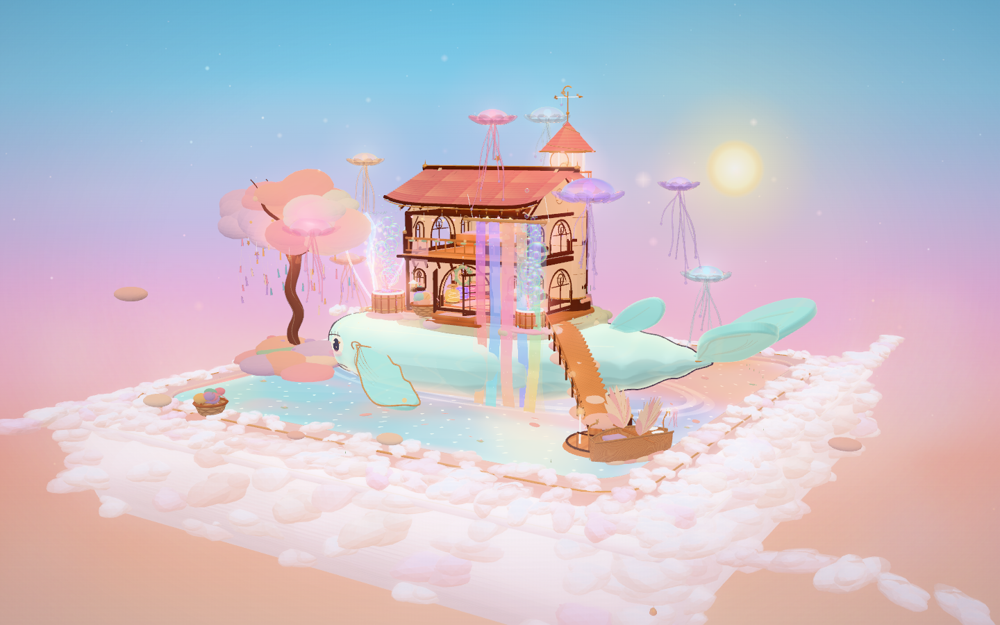

# Diorama Archive

Nineteen procedural Three.js dioramas. No Blender, no model files, no image assets — every mesh,
material, canvas texture, GLSL shader and animation is generated in the browser at runtime.

**[Open the archive →](https://cl0ud-99.github.io/diorama-archive/)**



Every entry below runs live in the browser — click a name to open it.

## Collection

| # | Diorama | Theme | three.js | Draw calls | Size | Code |
|---|---|---|---|---:|---:|---|
| A01 | [Black Lodge](https://cl0ud-99.github.io/diorama-archive/_extracted/a01-twin-peaks-lodge/TwinPeaks-BlackLodge/TwinPeaks-BlackLodge.html) | Film homage | r169 | 3,574 | 516K | module src/ |
| A02 | [Ashtray Maze](https://cl0ud-99.github.io/diorama-archive/_extracted/a02-ashtray-maze/ashtray-maze/standalone/ashtray-maze.html) | Film homage | r152 | 3,218 | 4.8M | module src/ |
| A03 | [Aurora Hourglass](https://cl0ud-99.github.io/diorama-archive/_extracted/a03-aurora-hourglass/aurora-hourglass/index.html) | Original fantasy | r160 | 721 | 456K | module src/ |
| A04 | [Autumn Farm](https://cl0ud-99.github.io/diorama-archive/_extracted/a04-autumn-farm/index.html) | Pastoral | r169 | 2,123 | 1.8M | single file |
| A05 | [Cliff Lighthouse Café](https://cl0ud-99.github.io/diorama-archive/_extracted/a05-cliff-lighthouse-cafe/cliff-lighthouse-cafe/index.html) | Retro | inline | 2,155 | 152K | minified |
| A06 | [Cloud Post Office](https://cl0ud-99.github.io/diorama-archive/_extracted/a06-cloud-post-office/cloud-post-office/index.html) | Original fantasy | inline UMD | 1,154 | 2.9M | module src/ |
| A07 | [FBC Quarry 07](https://cl0ud-99.github.io/diorama-archive/_extracted/a07-fbc-quarry/fbc-quarry/standalone/fbc-quarry-07.html) | Film homage | r150 | 3,043 | 15M | module src/ |
| A08 | [Redshift Archive](https://cl0ud-99.github.io/diorama-archive/_extracted/a08-fbc-redshift/fbc-redshift-archive/dist/FBC-Redshift-Archive.html) | Film homage | r186 | 1,502 | 12M | module src/ |
| A09 | [Grand Hotel](https://cl0ud-99.github.io/diorama-archive/_extracted/a09-grand-hotel/grand-hotel-diorama/grand-hotel-diorama.html) | Film style | r160 | 7,047 | 468K | module src/ |
| A10 | [The Lighthouse](https://cl0ud-99.github.io/diorama-archive/_extracted/a10-lighthouse/lighthouse-scene/lighthouse.html) | Retro | r160.1 | 864 | 1.6M | module src/ |
| A11 | [Lunar Outpost](https://cl0ud-99.github.io/diorama-archive/_extracted/a11-lunar-outpost/lunar-outpost/index-offline.html) | Sci-fi | r169 | 889 | 896K | single file |
| A12 | [Stutter Lab](https://cl0ud-99.github.io/diorama-archive/_extracted/a12-monach-stutter-lab/monach_stutter_lab/monach_stutter_lab.html) | Sci-fi | r160 | 1,530 | 296K | single file |
| A13 | [Mori Mart](https://cl0ud-99.github.io/diorama-archive/_extracted/a13-mori-mart/mori-mart/index.html) | Original fantasy | r160 | 1,776 | 1.3M | single file |
| A14 | [Polar Icebreaker](https://cl0ud-99.github.io/diorama-archive/_extracted/a14-polar-icebreaker/polar-icebreaker/polar-icebreaker.html) | Retro | r169 | 1,249 | 568K | single file |
| A15 | [Qipao Diorama](https://cl0ud-99.github.io/diorama-archive/_extracted/a15-qipao-diorama/qipao-diorama/standalone/qipao-diorama.html) | Retro | r150 | 944 | 17M | module src/ |
| A16 | [Route 66 Diner](https://cl0ud-99.github.io/diorama-archive/_extracted/a16-route66-diner/route66-diner/index.html) | Retro | inline | 2,345 | 156K | minified |
| A17 | [The Red Room](https://cl0ud-99.github.io/diorama-archive/_extracted/a17-twin-peaks-red-room/twin-peaks-red-room/standalone/twin-peaks-red-room.html) | Film homage | r150 | 1,754 | 15M | module src/ |
| A18 | [Sunset Dream Loom](https://cl0ud-99.github.io/diorama-archive/_extracted/a18-whale-dream-atelier/whale-dream-atelier/dist/dream-weaver-atelier.html) | Original fantasy | r186.1 | 2,606 | 15M | module src/ |
| A19 | [Hawkins / Upside Down](https://cl0ud-99.github.io/diorama-archive/_extracted/a19-stranger-things/stranger-things/stranger-things-hawkins-diorama.html) | Film homage | inline | 2,237 | 188K | single file |

`Draw calls` are measured, not estimated — see [Performance baseline](#performance-baseline).
A05 and A16 ship minified only: three.js and the scene code are fused into one IIFE, so there is no
readable source to edit.

## Repository layout

```
archive/
├─ index.html        visual index — thumbnails, filters, detail modals
├─ catalog.md        flat table + four filtered views          (Chinese)
├─ profiles.md       per-project dossier: what / how / pitfalls / where to optimise   (Chinese)
├─ README.md         this file
├─ CHANGELOG.md      what changed in each version
├─ VERSION           current version
├─ _packages/        19 original zip archives, named aNN-slug.zip
├─ _extracted/       unpacked working copies, same names
├─ previews/         19 screenshots, 1440×900, rendered from the running scenes
└─ _tools/
   ├─ shot.mjs       renders previews/Axx.png from the live scenes
   └─ probe.mjs      measures draw calls / triangles / fps for every entry
```

Each archive keeps its own internal layout; `_extracted/aNN-slug/aNN-slug/` is that project's root.

## Running locally

Most entries open by double-clicking their built HTML file. Exceptions:

- **A11, A12** need a local server — they use ES modules, which `file://` blocks.
- **A04** imports three.js from a CDN, so it needs network access.

```bash
# any static server works; the archive is plain files
python -m http.server 8080
# then open http://localhost:8080/index.html
```

Entries with a build step rebuild like this:

```bash
cd _extracted/a01-twin-peaks-lodge/TwinPeaks-BlackLodge
npm install && npm run build      # -> single inlined HTML
```

`_extracted/` does not ship `node_modules/` — A18's offline bundle included them, so run
`npm install` there before building.

## Performance baseline

`_tools/probe.mjs` instruments the WebGL context and counts real `drawElements` / `drawArrays`
calls per frame. It needs no debug handle from the project, so the same measurement applies to all
nineteen:

```bash
node _tools/probe.mjs            # all 19  (~8 min under software rendering)
node _tools/probe.mjs A09,A01    # selected
```

Measured at 1280×800 in headless Chrome on SwiftShader. Counts include the shadow pass and
post-processing, which is why they run higher than the figures quoted inside individual projects.
Frame-rate numbers from software rendering are only meaningful relative to each other.

Three findings worth knowing before optimising anything:

1. **Draw calls, not triangles, are the bottleneck.** The heaviest scene renders 1.17M triangles and
   holds up; the worst offender renders 345k and does not, because it issues ~7,000 calls per frame.
2. **A09 Grand Hotel is the outlier.** Its frame does three full scene traversals — a normal prepass
   for outline extraction, a shadow pass, then the colour pass. Its own documentation never says so.
3. **A11 Lunar Outpost measures 889 calls**, one of the cheapest entries, despite carrying by far the
   most detailed optimisation notes. Documentation quality and runtime cost are unrelated here.

## Versioning

Releases are tagged `vX.Y.Z`. The archive is kept byte-identical: `.gitattributes` sets `* -text`
and `core.autocrlf` is off, so no file is newline-converted on checkout.

See [CHANGELOG.md](CHANGELOG.md).

## Notes

- Roughly 87 MB of zip archives, 134 MB unpacked, 24 MB of previews.
- `catalog.md` and `profiles.md` are written in Chinese; everything else here is in English.
- Three filenames had to be repaired during archiving because their zips used a non-UTF-8 encoding
  (`a13-mori-mart`, `a19-stranger-things`, `a18-whale-dream-atelier`). File contents are untouched.
