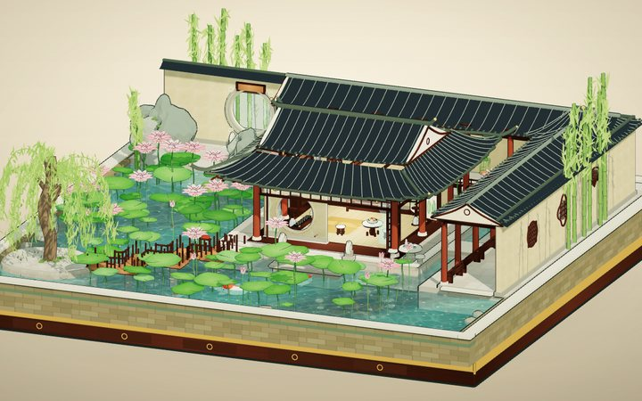
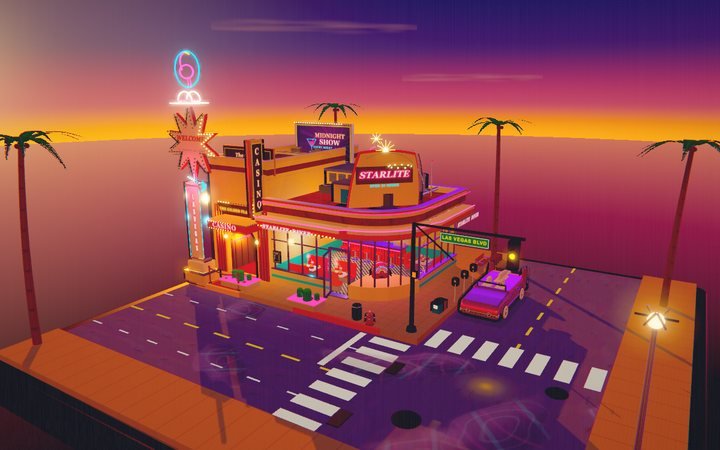
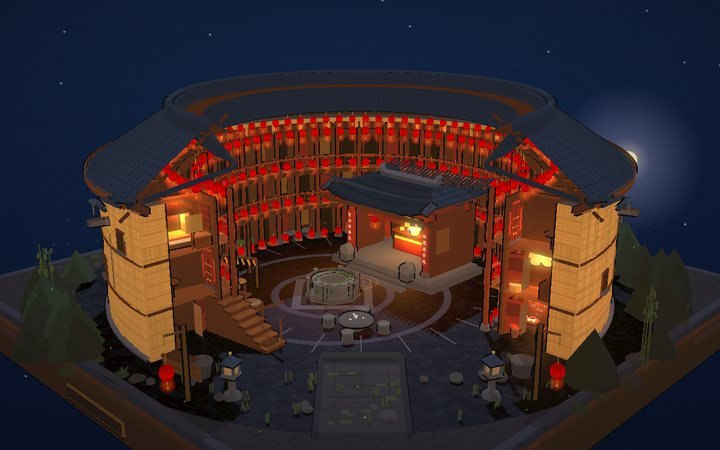
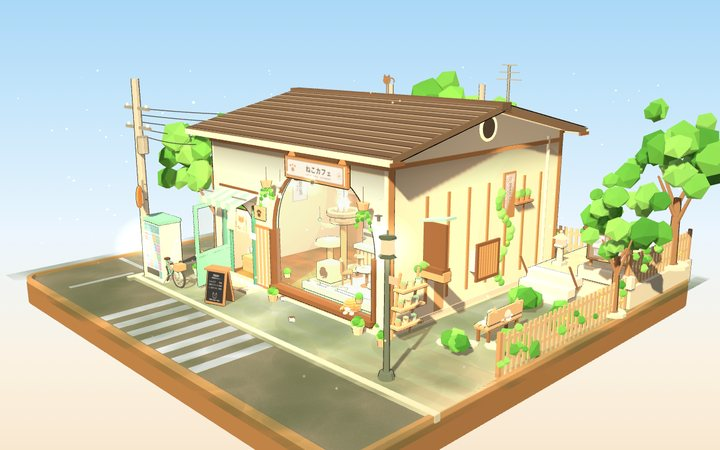
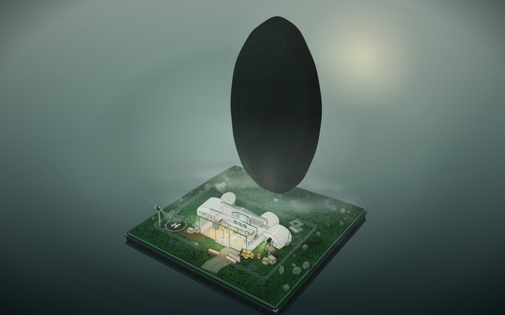
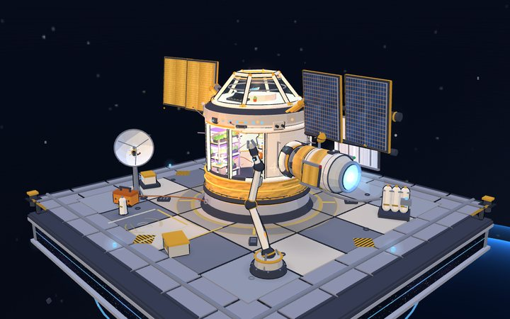
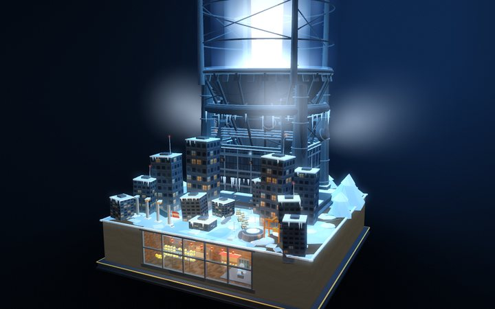
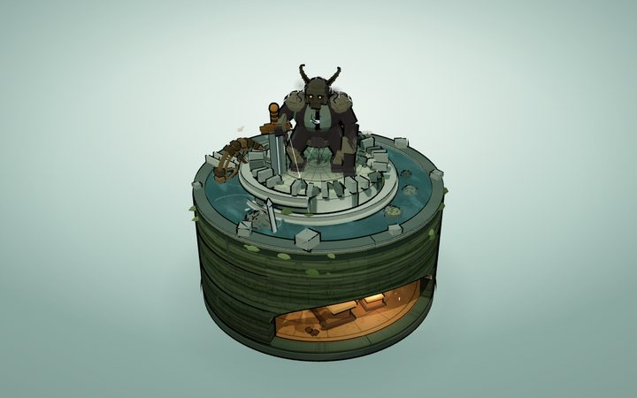
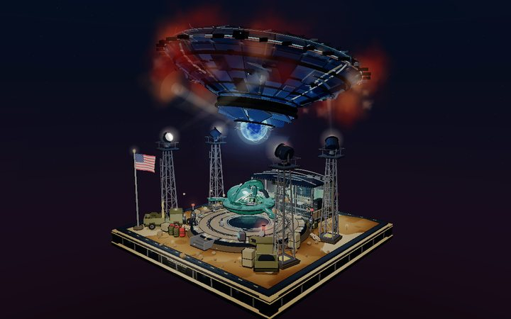

# DeepSeek Gallery

**DeepSeek V4.1 Flash 1017 的 3D 微缩场景作品集。**
32 件小世界，全部由代码生成——没有模型文件，没有贴图。

*A gallery of code-built 3D dioramas by DeepSeek V4.1 Flash 1017.*

**[在线画廊 →](https://cl0ud-99.github.io/deepseek-gallery/)** · **[可筛选的归档页 →](https://cl0ud-99.github.io/deepseek-gallery/archive.html)**

---

## 这是什么

没有 Blender，没有素材包，没有下载。屏幕上的每个立方体、每块砖、每片雨、每束光，都是浏览器当场算出来的。

这些作品是在对话里长出来的：描述一个想要的小世界，代码就一行行地把几何、材质、灯光写出来。

- **语言**：JavaScript —— ES Modules + Canvas 2D + WebGL，不需要构建链
- **引擎**：Three.js，r128 到 r186 都有，二十多件作品正好能看到引擎这几年的变化
- **资源**：0 个模型文件，0 张外部贴图。砖墙、招牌、唱片封套、霓虹字都是 Canvas 现画的；水面、极光、玻璃的手感是手写 GLSL
- **成品**：多是一个 `index.html`，最小 296KB、最大 17MB，双击就能看
- **交互**：拖拽转视角，滚轮 / 双指缩放；手机上双指拖动可以平移

## 作品

下面每一张都是活的：点缩略图或标题，就在浏览器里跑起来。

<table>
<tr>
<td align="center" width="160"><a href="https://cl0ud-99.github.io/deepseek-gallery/_extracted/a01-twin-peaks-lodge/TwinPeaks-BlackLodge/TwinPeaks-BlackLodge.html"></a><br><a href="https://cl0ud-99.github.io/deepseek-gallery/_extracted/a01-twin-peaks-lodge/TwinPeaks-BlackLodge/TwinPeaks-BlackLodge.html"><b>A01 · Black Lodge</b></a><br><sub>3,523 calls · r169 · 516K</sub></td>
<td align="center" width="160"><a href="https://cl0ud-99.github.io/deepseek-gallery/_extracted/a02-ashtray-maze/ashtray-maze/standalone/ashtray-maze.html"></a><br><a href="https://cl0ud-99.github.io/deepseek-gallery/_extracted/a02-ashtray-maze/ashtray-maze/standalone/ashtray-maze.html"><b>A02 · Ashtray Maze</b></a><br><sub>3,218 calls · r152 · 4.8M</sub></td>
<td align="center" width="160"><a href="https://cl0ud-99.github.io/deepseek-gallery/_extracted/a03-aurora-hourglass/aurora-hourglass/index.html"></a><br><a href="https://cl0ud-99.github.io/deepseek-gallery/_extracted/a03-aurora-hourglass/aurora-hourglass/index.html"><b>A03 · Aurora Hourglass</b></a><br><sub>721 calls · r160 · 456K</sub></td>
<td align="center" width="160"><a href="https://cl0ud-99.github.io/deepseek-gallery/_extracted/a04-autumn-farm/index.html"></a><br><a href="https://cl0ud-99.github.io/deepseek-gallery/_extracted/a04-autumn-farm/index.html"><b>A04 · Autumn Farm</b></a><br><sub>2,123 calls · r169 · 1.8M</sub></td>
<td align="center" width="160"><a href="https://cl0ud-99.github.io/deepseek-gallery/_extracted/a05-cliff-lighthouse-cafe/cliff-lighthouse-cafe/index.html"></a><br><a href="https://cl0ud-99.github.io/deepseek-gallery/_extracted/a05-cliff-lighthouse-cafe/cliff-lighthouse-cafe/index.html"><b>A05 · Cliff Lighthouse Café</b></a><br><sub>2,154 calls · r160 · 450K</sub></td>
</tr>
<tr>
<td align="center" width="160"><a href="https://cl0ud-99.github.io/deepseek-gallery/_extracted/a06-cloud-post-office/cloud-post-office/index.html"></a><br><a href="https://cl0ud-99.github.io/deepseek-gallery/_extracted/a06-cloud-post-office/cloud-post-office/index.html"><b>A06 · Cloud Post Office</b></a><br><sub>1,154 calls · inline UMD · 2.9M</sub></td>
<td align="center" width="160"><a href="https://cl0ud-99.github.io/deepseek-gallery/_extracted/a07-fbc-quarry/fbc-quarry/standalone/fbc-quarry-07.html"></a><br><a href="https://cl0ud-99.github.io/deepseek-gallery/_extracted/a07-fbc-quarry/fbc-quarry/standalone/fbc-quarry-07.html"><b>A07 · FBC Quarry 07</b></a><br><sub>3,043 calls · r150 · 15M</sub></td>
<td align="center" width="160"><a href="https://cl0ud-99.github.io/deepseek-gallery/_extracted/a08-fbc-redshift/fbc-redshift-archive/dist/FBC-Redshift-Archive.html"></a><br><a href="https://cl0ud-99.github.io/deepseek-gallery/_extracted/a08-fbc-redshift/fbc-redshift-archive/dist/FBC-Redshift-Archive.html"><b>A08 · Redshift Archive</b></a><br><sub>1,502 calls · r186 · 12M</sub></td>
<td align="center" width="160"><a href="https://cl0ud-99.github.io/deepseek-gallery/_extracted/a09-grand-hotel/grand-hotel-diorama/grand-hotel-diorama.html"></a><br><a href="https://cl0ud-99.github.io/deepseek-gallery/_extracted/a09-grand-hotel/grand-hotel-diorama/grand-hotel-diorama.html"><b>A09 · Grand Hotel</b></a><br><sub>1,009 calls · r160 · 468K</sub></td>
<td align="center" width="160"><a href="https://cl0ud-99.github.io/deepseek-gallery/_extracted/a10-lighthouse/lighthouse-scene/lighthouse.html"></a><br><a href="https://cl0ud-99.github.io/deepseek-gallery/_extracted/a10-lighthouse/lighthouse-scene/lighthouse.html"><b>A10 · The Lighthouse</b></a><br><sub>864 calls · r160.1 · 1.6M</sub></td>
</tr>
<tr>
<td align="center" width="160"><a href="https://cl0ud-99.github.io/deepseek-gallery/_extracted/a11-lunar-outpost/lunar-outpost/index-offline.html"></a><br><a href="https://cl0ud-99.github.io/deepseek-gallery/_extracted/a11-lunar-outpost/lunar-outpost/index-offline.html"><b>A11 · Lunar Outpost</b></a><br><sub>889 calls · r169 · 896K</sub></td>
<td align="center" width="160"><a href="https://cl0ud-99.github.io/deepseek-gallery/_extracted/a12-monach-stutter-lab/monach_stutter_lab/monach_stutter_lab.html"></a><br><a href="https://cl0ud-99.github.io/deepseek-gallery/_extracted/a12-monach-stutter-lab/monach_stutter_lab/monach_stutter_lab.html"><b>A12 · Stutter Lab</b></a><br><sub>1,529 calls · r160 · 296K</sub></td>
<td align="center" width="160"><a href="https://cl0ud-99.github.io/deepseek-gallery/_extracted/a13-mori-mart/mori-mart/index.html"></a><br><a href="https://cl0ud-99.github.io/deepseek-gallery/_extracted/a13-mori-mart/mori-mart/index.html"><b>A13 · Mori Mart</b></a><br><sub>1,775 calls · r160 · 1.3M</sub></td>
<td align="center" width="160"><a href="https://cl0ud-99.github.io/deepseek-gallery/_extracted/a14-polar-icebreaker/polar-icebreaker/polar-icebreaker.html"></a><br><a href="https://cl0ud-99.github.io/deepseek-gallery/_extracted/a14-polar-icebreaker/polar-icebreaker/polar-icebreaker.html"><b>A14 · Polar Icebreaker</b></a><br><sub>1,249 calls · r169 · 568K</sub></td>
<td align="center" width="160"><a href="https://cl0ud-99.github.io/deepseek-gallery/_extracted/a15-qipao-diorama/qipao-diorama/standalone/qipao-diorama.html"></a><br><a href="https://cl0ud-99.github.io/deepseek-gallery/_extracted/a15-qipao-diorama/qipao-diorama/standalone/qipao-diorama.html"><b>A15 · Qipao Diorama</b></a><br><sub>940 calls · r150 · 17M</sub></td>
</tr>
<tr>
<td align="center" width="160"><a href="https://cl0ud-99.github.io/deepseek-gallery/_extracted/a16-route66-diner/route66-diner/index.html"></a><br><a href="https://cl0ud-99.github.io/deepseek-gallery/_extracted/a16-route66-diner/route66-diner/index.html"><b>A16 · Route 66 Diner</b></a><br><sub>2,355 calls · r160 · 459K</sub></td>
<td align="center" width="160"><a href="https://cl0ud-99.github.io/deepseek-gallery/_extracted/a17-twin-peaks-red-room/twin-peaks-red-room/standalone/twin-peaks-red-room.html"></a><br><a href="https://cl0ud-99.github.io/deepseek-gallery/_extracted/a17-twin-peaks-red-room/twin-peaks-red-room/standalone/twin-peaks-red-room.html"><b>A17 · The Red Room</b></a><br><sub>1,754 calls · r150 · 15M</sub></td>
<td align="center" width="160"><a href="https://cl0ud-99.github.io/deepseek-gallery/_extracted/a18-whale-dream-atelier/whale-dream-atelier/dist/dream-weaver-atelier.html"></a><br><a href="https://cl0ud-99.github.io/deepseek-gallery/_extracted/a18-whale-dream-atelier/whale-dream-atelier/dist/dream-weaver-atelier.html"><b>A18 · Sunset Dream Loom</b></a><br><sub>2,606 calls · r186.1 · 15M</sub></td>
<td align="center" width="160"><a href="https://cl0ud-99.github.io/deepseek-gallery/_extracted/a19-stranger-things/hawkins-mirror/hawkins-mirror.html"></a><br><a href="https://cl0ud-99.github.io/deepseek-gallery/_extracted/a19-stranger-things/hawkins-mirror/hawkins-mirror.html"><b>A19 · Hawkins / Upside Down</b></a><br><sub>2,739 calls · r149 · 3.4M</sub></td>
<td align="center" width="160"><a href="https://cl0ud-99.github.io/deepseek-gallery/_extracted/a20-moonlit-perfume-atelier/moonlit-perfume-atelier/index.html"></a><br><a href="https://cl0ud-99.github.io/deepseek-gallery/_extracted/a20-moonlit-perfume-atelier/moonlit-perfume-atelier/index.html"><b>A20 · Moonlit Perfume Atelier</b></a><br><sub>1,027 calls · r160 · 1.3M</sub></td>
</tr>
<tr>
<td align="center" width="160"><a href="https://cl0ud-99.github.io/deepseek-gallery/_extracted/a21-ice-fire-mine-station/ice-fire-mine-station/index.html"></a><br><a href="https://cl0ud-99.github.io/deepseek-gallery/_extracted/a21-ice-fire-mine-station/ice-fire-mine-station/index.html"><b>A21 · Ice-Fire Mine Station</b></a><br><sub>3,350 calls · r160 · 586K</sub></td>
<td align="center" width="160"><a href="https://cl0ud-99.github.io/deepseek-gallery/_extracted/a22-floating-lava-glacier/index.html"></a><br><a href="https://cl0ud-99.github.io/deepseek-gallery/_extracted/a22-floating-lava-glacier/index.html"><b>A22 · Floating Lava Glacier</b></a><br><sub>lava · ice · underwater</sub></td>
<td align="center" width="160"><a href="https://cl0ud-99.github.io/deepseek-gallery/_extracted/a23-carnival/carnival-miniature/carnival.html"></a><br><a href="https://cl0ud-99.github.io/deepseek-gallery/_extracted/a23-carnival/carnival-miniature/carnival.html"><b>A23 · Summer Night Carnival</b></a><br><sub>carousel · fireworks · r128</sub></td>
<td align="center" width="160"><a href="https://cl0ud-99.github.io/deepseek-gallery/_extracted/a24-jiangnan-garden/jiangnan-garden/index.html"></a><br><a href="https://cl0ud-99.github.io/deepseek-gallery/_extracted/a24-jiangnan-garden/jiangnan-garden/index.html"><b>A24 · Jiangnan Garden</b></a><br><sub>≈2,000 calls · r160 · 614K</sub></td>
<td align="center" width="160"><a href="https://cl0ud-99.github.io/deepseek-gallery/_extracted/a25-las-vegas/las-vegas-diorama/index.html"></a><br><a href="https://cl0ud-99.github.io/deepseek-gallery/_extracted/a25-las-vegas/las-vegas-diorama/index.html"><b>A25 · Las Vegas — Sunset Boulevard</b></a><br><sub>1,378 mesh · r180 · 811K</sub></td>
</tr>
<tr>
<td align="center" width="160"><a href="https://cl0ud-99.github.io/deepseek-gallery/_extracted/a26-tulou/tulou/index.html"></a><br><a href="https://cl0ud-99.github.io/deepseek-gallery/_extracted/a26-tulou/tulou/index.html"><b>A26 · Tulou Reunion Night</b></a><br><sub>≈40 calls · r160 · 764K</sub></td>
<td align="center" width="160"><a href="https://cl0ud-99.github.io/deepseek-gallery/_extracted/a27-cat-cafe/cat-cafe/index.html"></a><br><a href="https://cl0ud-99.github.io/deepseek-gallery/_extracted/a27-cat-cafe/cat-cafe/index.html"><b>A27 · Corner Cat Café</b></a><br><sub>1,585 calls · r158 · 758K</sub></td>
<td align="center" width="160"><a href="https://cl0ud-99.github.io/deepseek-gallery/_extracted/a28-arrival/arrival/index.html"></a><br><a href="https://cl0ud-99.github.io/deepseek-gallery/_extracted/a28-arrival/arrival/index.html"><b>A28 · Arrival</b></a><br><sub>monolith · valley · 762K</sub></td>
<td align="center" width="160"><a href="https://cl0ud-99.github.io/deepseek-gallery/_extracted/a29-orbital-station/orbital-station/index.html"></a><br><a href="https://cl0ud-99.github.io/deepseek-gallery/_extracted/a29-orbital-station/orbital-station/index.html"><b>A29 · Orbital Station</b></a><br><sub>station · solar wings · 764K</sub></td>
<td align="center" width="160"><a href="https://cl0ud-99.github.io/deepseek-gallery/_extracted/a30-wandering-earth/wandering-earth/index.html"></a><br><a href="https://cl0ud-99.github.io/deepseek-gallery/_extracted/a30-wandering-earth/wandering-earth/index.html"><b>A30 · Wandering Earth — Planetary Engine</b></a><br><sub>engine · snow · 703K</sub></td>
</tr>
<tr>
<td align="center" width="160"><a href="https://cl0ud-99.github.io/deepseek-gallery/_extracted/a31-shadow-colossus/shadow-colossus/index.html"></a><br><a href="https://cl0ud-99.github.io/deepseek-gallery/_extracted/a31-shadow-colossus/shadow-colossus/index.html"><b>A31 · Lakeside Shrine — Gaius</b></a><br><sub>1,400 calls · r157 · 753K</sub></td>
<td align="center" width="160"><a href="https://cl0ud-99.github.io/deepseek-gallery/_extracted/a32-area51/area51/index.html"></a><br><a href="https://cl0ud-99.github.io/deepseek-gallery/_extracted/a32-area51/area51/index.html"><b>A32 · Independence Day — Area 51</b></a><br><sub>2,300 mesh · r128 · 777K</sub></td>
</tr>
</table>

卡片下面的 `calls` 是实测的每帧绘制调用数（1280×800、软件渲染、含阴影与后期），不是估算。最高的是 Black Lodge 的 3,523，最低的是 Aurora Hourglass 的 721——贵不代表好看，但确实值得知道。

## 怎么跑

只想看：直接开 **[在线画廊](https://cl0ud-99.github.io/deepseek-gallery/)**，或者按题材翻 **[归档页](https://cl0ud-99.github.io/deepseek-gallery/archive.html)**。

想本地跑：

```bash
python -m http.server 8080
# 然后打开 http://localhost:8080/
```

`_extracted/` 里是 32 件的完整源码和入口，每个场景的入口 HTML 也能单独打开。两个例外：A11、A12 用了 ES Module，需要本地服务；A04 从 CDN 取 Three.js，需要联网。

## 幕后

想深挖的话，这些都在仓库里：

- [docs/AUDIT.md](docs/AUDIT.md) —— 场景图审计：网格、三角面、描边壳、重复面，以及还能怎么合批
- [docs/catalog.md](docs/catalog.md) —— 平铺总表，按题材 / 可改性 / 开销筛选
- [docs/profiles.md](docs/profiles.md) —— 逐件档案：里面有什么、怎么实现、踩过哪些坑
- [docs/ADDING.md](docs/ADDING.md) —— 想加一件自己的，照这个清单走
- [CHANGELOG.md](CHANGELOG.md) —— 每个版本改了什么

## 投稿

也欢迎别人的场景。要求就两条：能从单个入口在浏览器里跑起来，而且是拿代码搭的（不导入模型、不导入贴图）。

1. 场景放进 `_extracted/aXX-<slug>/`
2. `node _tools/framed-shot.mjs AXX` 拍一张 1440×900 预览（细节见 [docs/ADDING.md](docs/ADDING.md)）
3. 在 `index.html` 的 `WORKS` 和 `SRC` 里各加一条
4. 开 PR，或者 [开 issue](https://github.com/Cl0ud-99/deepseek-gallery/issues/new) 附 zip

页面加载时会自检：源码路径缺失、id 重复、预览图缺失，都会在 console 里点名，不会静默失败。

---

## English

**A gallery of code-built 3D dioramas by DeepSeek V4.1 Flash 1017.**
Thirty-two small worlds, all generated as code — no model files, no textures.

### What this is

No Blender, no asset pack, no download. Every cube, brick, raindrop and light beam on screen is computed in the browser at runtime.

- **Language**: JavaScript — ES Modules, Canvas 2D and WebGL, no build step
- **Engine**: Three.js, r128 through r186
- **Assets**: zero model files, zero image files — brickwork, signage, record sleeves and neon lettering are drawn on a canvas; water, aurora and glass are hand-written GLSL
- **Output**: mostly a single `index.html`, from 296KB to 17MB, double-click to open
- **Interaction**: drag to orbit, wheel or pinch to zoom, two-finger drag to pan on touch screens

The 32 thumbnails above are live scenes — click one to run it. The `calls` figure on each card is the measured draw calls per frame (1280×800, software rendering, shadows and post-processing included), not an estimate.

### Run it locally

```bash
python -m http.server 8080
# then open http://localhost:8080/
```

All 23 scenes live in `_extracted/`, each with its own entry HTML. Two exceptions: A11 and A12 use ES modules and need a local server; A04 pulls Three.js from a CDN and needs network access.

### Under the hood

- [docs/AUDIT.md](docs/AUDIT.md) — scene-graph audit: meshes, triangles, outline shells, duplicate faces, batching headroom
- [docs/catalog.md](docs/catalog.md) — flat table, filterable by theme / editability / cost
- [docs/profiles.md](docs/profiles.md) — per-project dossier: what's inside, how it's built, what bit us
- [docs/ADDING.md](docs/ADDING.md) — checklist for adding a piece
- [CHANGELOG.md](CHANGELOG.md) — what changed in each version

### Contribute

Scenes from other people are welcome. Two rules: it must run in a browser from a single entry point, and it must be built with code (no imported models or textures).

1. Put the scene under `_extracted/aXX-<slug>/`
2. Render a 1440×900 preview with `node _tools/framed-shot.mjs AXX` (details in [docs/ADDING.md](docs/ADDING.md))
3. Add one entry to `WORKS` and one to `SRC` in `index.html`
4. Open a PR, or [open an issue](https://github.com/Cl0ud-99/deepseek-gallery/issues/new) and attach a zip

The page self-checks on load: a missing source path, a duplicate id or a missing preview is reported in the console instead of failing silently.

---

<sub>Version in `VERSION`; releases are tagged `vX.Y.Z`. All code, previews and scenes live in this repository.</sub>
