# DeepSeek Gallery

A community gallery of dioramas built entirely in code — no model files, no image assets.
Every mesh, material, canvas texture, GLSL shader and animation is generated in the browser
at runtime with Three.js.

**[Open the gallery →](https://cl0ud-99.github.io/deepseek-gallery/)** · **[Filterable archive →](https://cl0ud-99.github.io/deepseek-gallery/archive.html)**

## Submit a piece

Anyone can contribute a scene. What we look for: it runs in a browser from a single entry file,
and it is built with code rather than imported assets.

1. Put the scene under `_extracted/aXX-<slug>/` — a self-contained `index.html` is ideal.
2. Render a 1440×900 preview with `node _tools/framed-shot.mjs AXX` (details in `_lab/ADDING.md`).
3. Add one entry to `WORKS` and one to `SRC` in `index.html`.
4. Open a PR, or [start an issue](https://github.com/Cl0ud-99/deepseek-gallery/issues/new) and
   attach a zip — we will wire it in.

The page self-checks on load: a missing source path, a duplicate id or a missing preview is
reported in the console instead of failing silently.

## Collection

Every preview below is a live scene: click a thumbnail or a title to run it in the browser.

<table>
<tr>
<td align="center" width="280"><a href="https://cl0ud-99.github.io/deepseek-gallery/_extracted/a01-twin-peaks-lodge/TwinPeaks-BlackLodge/TwinPeaks-BlackLodge.html">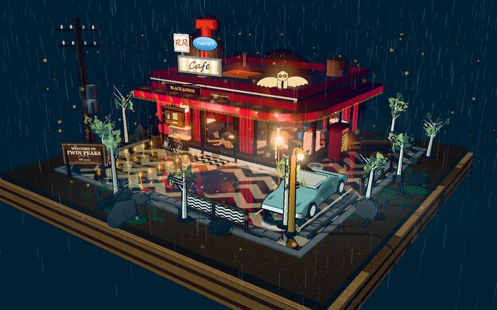</a><br><a href="https://cl0ud-99.github.io/deepseek-gallery/_extracted/a01-twin-peaks-lodge/TwinPeaks-BlackLodge/TwinPeaks-BlackLodge.html"><b>A01 · Black Lodge</b></a><br><sub>3,523 calls · r169 · 516K</sub></td>
<td align="center" width="280"><a href="https://cl0ud-99.github.io/deepseek-gallery/_extracted/a02-ashtray-maze/ashtray-maze/standalone/ashtray-maze.html">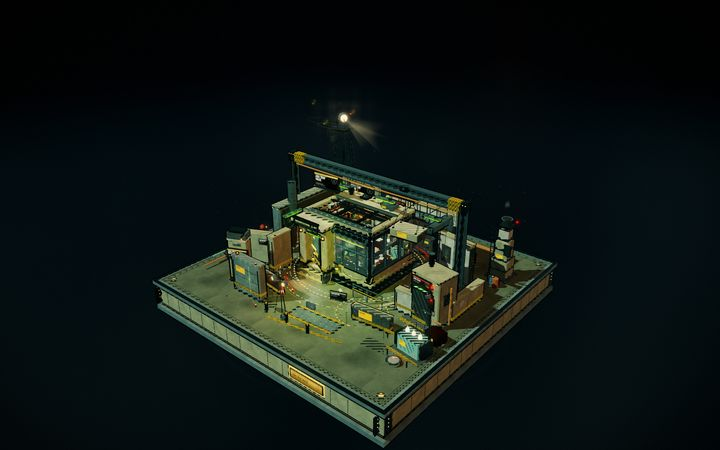</a><br><a href="https://cl0ud-99.github.io/deepseek-gallery/_extracted/a02-ashtray-maze/ashtray-maze/standalone/ashtray-maze.html"><b>A02 · Ashtray Maze</b></a><br><sub>3,218 calls · r152 · 4.8M</sub></td>
<td align="center" width="280"><a href="https://cl0ud-99.github.io/deepseek-gallery/_extracted/a03-aurora-hourglass/aurora-hourglass/index.html">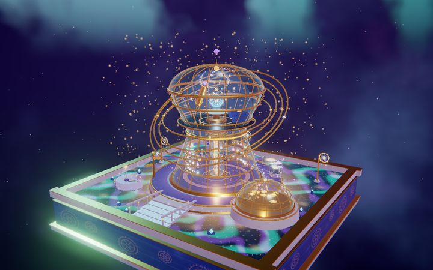</a><br><a href="https://cl0ud-99.github.io/deepseek-gallery/_extracted/a03-aurora-hourglass/aurora-hourglass/index.html"><b>A03 · Aurora Hourglass</b></a><br><sub>721 calls · r160 · 456K</sub></td>
</tr>
<tr>
<td align="center" width="280"><a href="https://cl0ud-99.github.io/deepseek-gallery/_extracted/a04-autumn-farm/index.html">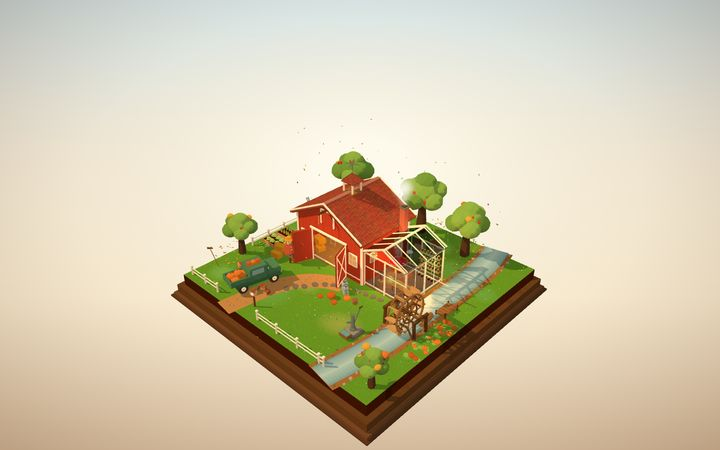</a><br><a href="https://cl0ud-99.github.io/deepseek-gallery/_extracted/a04-autumn-farm/index.html"><b>A04 · Autumn Farm</b></a><br><sub>2,123 calls · r169 · 1.8M</sub></td>
<td align="center" width="280"><a href="https://cl0ud-99.github.io/deepseek-gallery/_extracted/a05-cliff-lighthouse-cafe/cliff-lighthouse-cafe/index.html">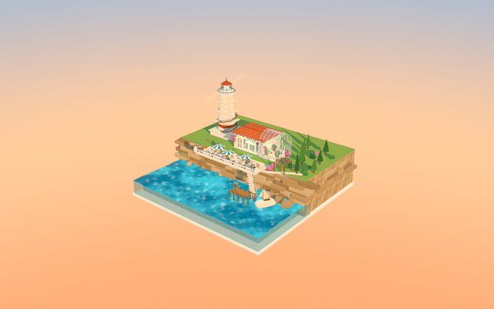</a><br><a href="https://cl0ud-99.github.io/deepseek-gallery/_extracted/a05-cliff-lighthouse-cafe/cliff-lighthouse-cafe/index.html"><b>A05 · Cliff Lighthouse Café</b></a><br><sub>2,154 calls · r160 · 450K</sub></td>
<td align="center" width="280"><a href="https://cl0ud-99.github.io/deepseek-gallery/_extracted/a06-cloud-post-office/cloud-post-office/index.html">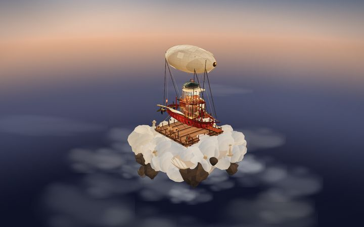</a><br><a href="https://cl0ud-99.github.io/deepseek-gallery/_extracted/a06-cloud-post-office/cloud-post-office/index.html"><b>A06 · Cloud Post Office</b></a><br><sub>1,154 calls · inline UMD · 2.9M</sub></td>
</tr>
<tr>
<td align="center" width="280"><a href="https://cl0ud-99.github.io/deepseek-gallery/_extracted/a07-fbc-quarry/fbc-quarry/standalone/fbc-quarry-07.html">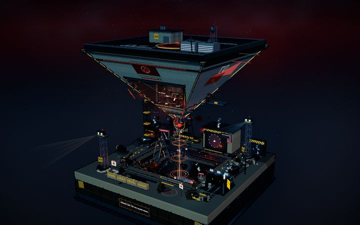</a><br><a href="https://cl0ud-99.github.io/deepseek-gallery/_extracted/a07-fbc-quarry/fbc-quarry/standalone/fbc-quarry-07.html"><b>A07 · FBC Quarry 07</b></a><br><sub>3,043 calls · r150 · 15M</sub></td>
<td align="center" width="280"><a href="https://cl0ud-99.github.io/deepseek-gallery/_extracted/a08-fbc-redshift/fbc-redshift-archive/dist/FBC-Redshift-Archive.html">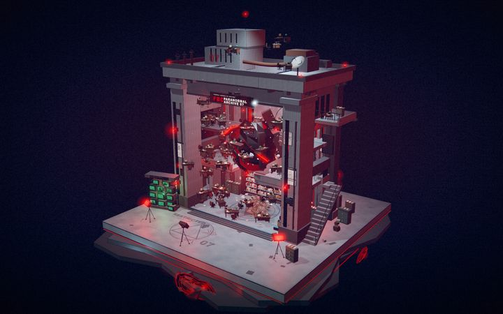</a><br><a href="https://cl0ud-99.github.io/deepseek-gallery/_extracted/a08-fbc-redshift/fbc-redshift-archive/dist/FBC-Redshift-Archive.html"><b>A08 · Redshift Archive</b></a><br><sub>1,502 calls · r186 · 12M</sub></td>
<td align="center" width="280"><a href="https://cl0ud-99.github.io/deepseek-gallery/_extracted/a09-grand-hotel/grand-hotel-diorama/grand-hotel-diorama.html">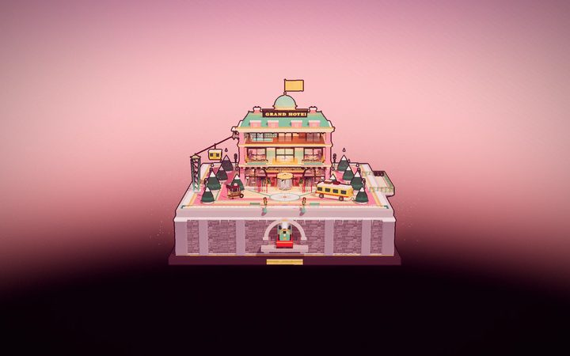</a><br><a href="https://cl0ud-99.github.io/deepseek-gallery/_extracted/a09-grand-hotel/grand-hotel-diorama/grand-hotel-diorama.html"><b>A09 · Grand Hotel</b></a><br><sub>1,009 calls · r160 · 468K</sub></td>
</tr>
<tr>
<td align="center" width="280"><a href="https://cl0ud-99.github.io/deepseek-gallery/_extracted/a10-lighthouse/lighthouse-scene/lighthouse.html">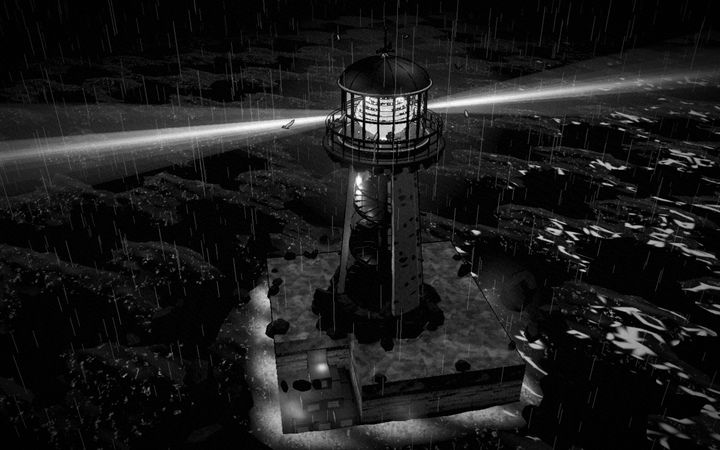</a><br><a href="https://cl0ud-99.github.io/deepseek-gallery/_extracted/a10-lighthouse/lighthouse-scene/lighthouse.html"><b>A10 · The Lighthouse</b></a><br><sub>864 calls · r160.1 · 1.6M</sub></td>
<td align="center" width="280"><a href="https://cl0ud-99.github.io/deepseek-gallery/_extracted/a11-lunar-outpost/lunar-outpost/index-offline.html">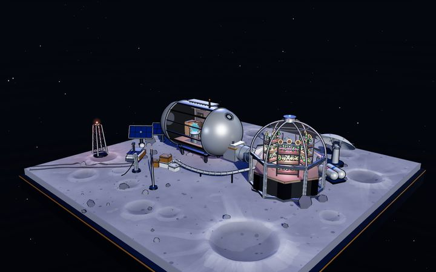</a><br><a href="https://cl0ud-99.github.io/deepseek-gallery/_extracted/a11-lunar-outpost/lunar-outpost/index-offline.html"><b>A11 · Lunar Outpost</b></a><br><sub>889 calls · r169 · 896K</sub></td>
<td align="center" width="280"><a href="https://cl0ud-99.github.io/deepseek-gallery/_extracted/a12-monach-stutter-lab/monach_stutter_lab/monach_stutter_lab.html">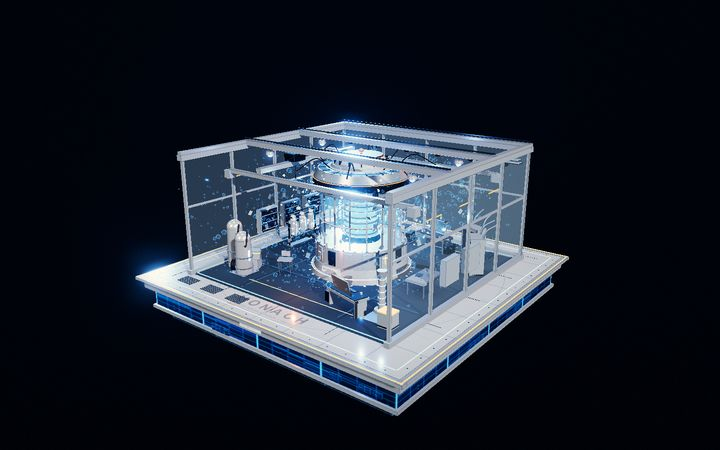</a><br><a href="https://cl0ud-99.github.io/deepseek-gallery/_extracted/a12-monach-stutter-lab/monach_stutter_lab/monach_stutter_lab.html"><b>A12 · Stutter Lab</b></a><br><sub>1,529 calls · r160 · 296K</sub></td>
</tr>
<tr>
<td align="center" width="280"><a href="https://cl0ud-99.github.io/deepseek-gallery/_extracted/a13-mori-mart/mori-mart/index.html">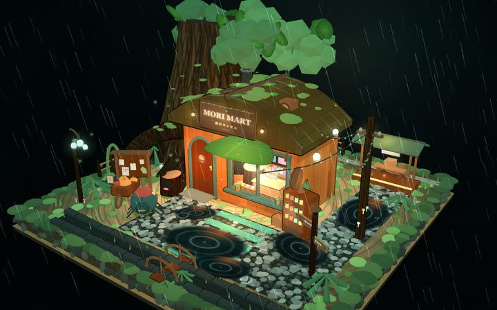</a><br><a href="https://cl0ud-99.github.io/deepseek-gallery/_extracted/a13-mori-mart/mori-mart/index.html"><b>A13 · Mori Mart</b></a><br><sub>1,775 calls · r160 · 1.3M</sub></td>
<td align="center" width="280"><a href="https://cl0ud-99.github.io/deepseek-gallery/_extracted/a14-polar-icebreaker/polar-icebreaker/polar-icebreaker.html">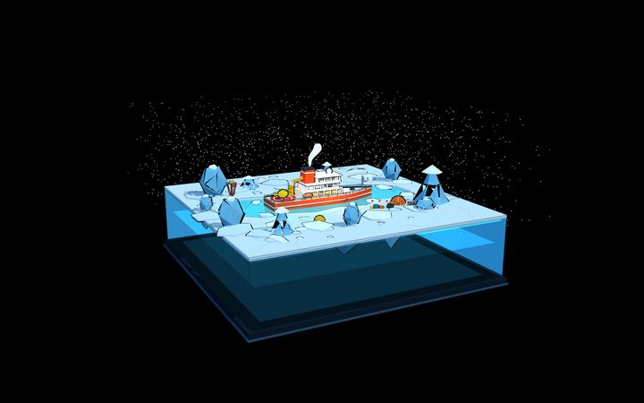</a><br><a href="https://cl0ud-99.github.io/deepseek-gallery/_extracted/a14-polar-icebreaker/polar-icebreaker/polar-icebreaker.html"><b>A14 · Polar Icebreaker</b></a><br><sub>1,249 calls · r169 · 568K</sub></td>
<td align="center" width="280"><a href="https://cl0ud-99.github.io/deepseek-gallery/_extracted/a15-qipao-diorama/qipao-diorama/standalone/qipao-diorama.html">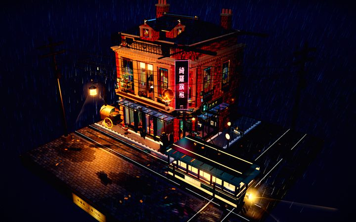</a><br><a href="https://cl0ud-99.github.io/deepseek-gallery/_extracted/a15-qipao-diorama/qipao-diorama/standalone/qipao-diorama.html"><b>A15 · Qipao Diorama</b></a><br><sub>940 calls · r150 · 17M</sub></td>
</tr>
<tr>
<td align="center" width="280"><a href="https://cl0ud-99.github.io/deepseek-gallery/_extracted/a16-route66-diner/route66-diner/index.html">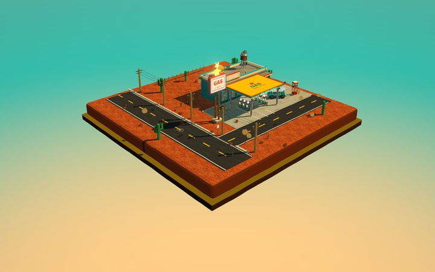</a><br><a href="https://cl0ud-99.github.io/deepseek-gallery/_extracted/a16-route66-diner/route66-diner/index.html"><b>A16 · Route 66 Diner</b></a><br><sub>2,355 calls · r160 · 459K</sub></td>
<td align="center" width="280"><a href="https://cl0ud-99.github.io/deepseek-gallery/_extracted/a17-twin-peaks-red-room/twin-peaks-red-room/standalone/twin-peaks-red-room.html">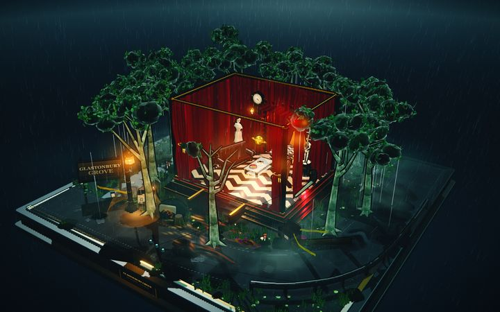</a><br><a href="https://cl0ud-99.github.io/deepseek-gallery/_extracted/a17-twin-peaks-red-room/twin-peaks-red-room/standalone/twin-peaks-red-room.html"><b>A17 · The Red Room</b></a><br><sub>1,754 calls · r150 · 15M</sub></td>
<td align="center" width="280"><a href="https://cl0ud-99.github.io/deepseek-gallery/_extracted/a18-whale-dream-atelier/whale-dream-atelier/dist/dream-weaver-atelier.html"></a><br><a href="https://cl0ud-99.github.io/deepseek-gallery/_extracted/a18-whale-dream-atelier/whale-dream-atelier/dist/dream-weaver-atelier.html"><b>A18 · Sunset Dream Loom</b></a><br><sub>2,606 calls · r186.1 · 15M</sub></td>
</tr>
<tr>
<td align="center" width="280"><a href="https://cl0ud-99.github.io/deepseek-gallery/_extracted/a19-stranger-things/hawkins-mirror/hawkins-mirror.html">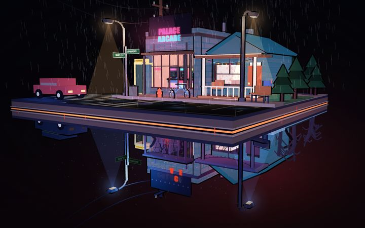</a><br><a href="https://cl0ud-99.github.io/deepseek-gallery/_extracted/a19-stranger-things/hawkins-mirror/hawkins-mirror.html"><b>A19 · Hawkins / Upside Down</b></a><br><sub>2,739 calls · r149 · 3.4M</sub></td>
<td align="center" width="280"><a href="https://cl0ud-99.github.io/deepseek-gallery/_extracted/a20-moonlit-perfume-atelier/moonlit-perfume-atelier/index.html">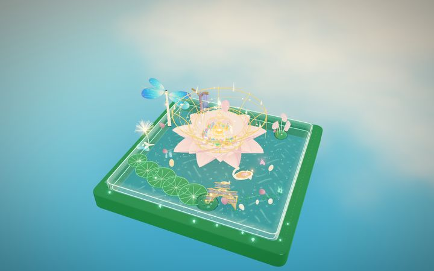</a><br><a href="https://cl0ud-99.github.io/deepseek-gallery/_extracted/a20-moonlit-perfume-atelier/moonlit-perfume-atelier/index.html"><b>A20 · Moonlit Perfume Atelier</b></a><br><sub>1,027 calls · r160 · 1.3M</sub></td>
<td align="center" width="280"><a href="https://cl0ud-99.github.io/deepseek-gallery/_extracted/a21-ice-fire-mine-station/ice-fire-mine-station/index.html">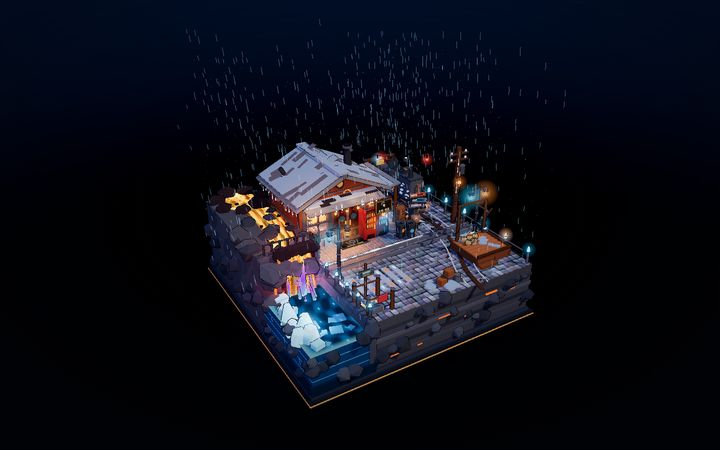</a><br><a href="https://cl0ud-99.github.io/deepseek-gallery/_extracted/a21-ice-fire-mine-station/ice-fire-mine-station/index.html"><b>A21 · Ice-Fire Mine Station</b></a><br><sub>3,350 calls · r160 · 586K</sub></td>
<td align="center" width="280"><a href="https://cl0ud-99.github.io/deepseek-gallery/_extracted/a22-floating-lava-glacier/index.html">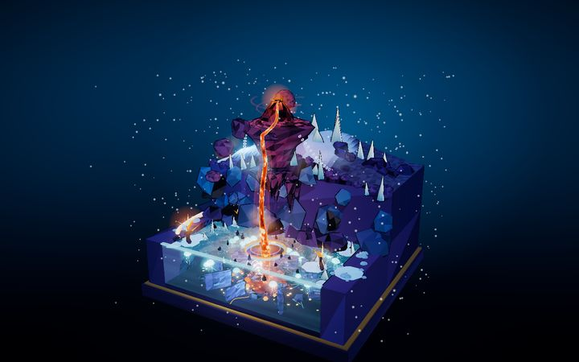</a><br><a href="https://cl0ud-99.github.io/deepseek-gallery/_extracted/a22-floating-lava-glacier/index.html"><b>A22 · Floating Lava Glacier</b></a><br><sub>lava · ice · underwater</sub></td>
<td align="center" width="280"><a href="https://cl0ud-99.github.io/deepseek-gallery/_extracted/a23-carnival/carnival-miniature/carnival.html">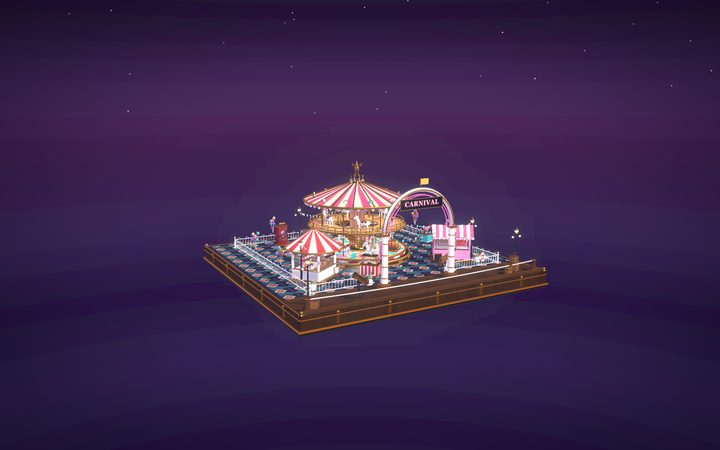</a><br><a href="https://cl0ud-99.github.io/deepseek-gallery/_extracted/a23-carnival/carnival-miniature/carnival.html"><b>A23 · Summer Night Carnival</b></a><br><sub>carousel · fireworks · r128</sub></td>
</tr>
</table>

Draw calls are measured, not estimated — see [Performance baseline](#performance-baseline).
All twenty-three now ship readable source. A05 and A16 were originally minified-only exports; both gained
`src/scene.js` plus a local `lib/` on 2026-10-30, with the built single file left byte-identical.

## Repository layout

```
archive/
├─ index.html        visual index — thumbnails, filters, in-page live preview
├─ catalog.md        flat table + four filtered views                        (Chinese)
├─ profiles.md       per-project dossier: what / how / pitfalls / where to optimise   (Chinese)
├─ README.md         this file
├─ AUDIT.md          scene-graph audit: structure, batching headroom, overlapping faces   (Chinese)
├─ CHANGELOG.md      what changed in each version
├─ VERSION           current version
├─ _packages/        19 original zip archives, named aNN-slug.zip
├─ _extracted/       unpacked working copies, same names
├─ previews/         19 screenshots, 1440×900, rendered from the running scenes
│  └─ thumbs/        720×450 JPEGs used by the gallery above
└─ _tools/
   ├─ shot.mjs       renders previews/Axx.png from the live scenes
   ├─ probe.mjs      measures draw calls / triangles / fps for every entry
   ├─ audit.mjs      scene-graph audit: meshes, materials, batching headroom, duplicate faces
   └─ overlap.mjs    traces every duplicate triangle back to the two objects that own it
```

## Running locally

Most entries open by double-clicking their built HTML file. Exceptions:

- **A11, A12** need a local server — they use ES modules, which `file://` blocks.
- **A04** imports three.js from a CDN, so it needs network access.

```bash
# any static server works; the archive is plain files
python -m http.server 8080
# then open http://localhost:8080/index.html
```

Entries with a build step rebuild like this:

```bash
cd _extracted/a01-twin-peaks-lodge/TwinPeaks-BlackLodge
npm install && npm run build      # -> single inlined HTML
```

`_extracted/` does not ship `node_modules/` — A18's offline bundle included them, so run
`npm install` there before building.

## Performance baseline

`_tools/probe.mjs` instruments the WebGL context and counts real `drawElements` / `drawArrays`
calls per frame. It needs no debug handle from the project, so the same measurement applies to all
nineteen:

```bash
node _tools/probe.mjs            # all 19  (~8 min under software rendering)
node _tools/probe.mjs A09,A01    # selected
```

Measured at 1280×800 in headless Chrome on SwiftShader. Counts include the shadow pass and
post-processing, which is why they run higher than the figures quoted inside individual projects.
Frame rates under software rendering are only meaningful relative to each other.

| # | Diorama | Draw calls | three.js | Size |
|---|---|---:|---|---:|
| A01 | Black Lodge | 3,523 | r169 | 516K |
| A21 | Ice-Fire Mine Station | 3,350 | r160 | 586K |
| A02 | Ashtray Maze | 3,218 | r152 | 4.8M |
| A07 | FBC Quarry 07 | 3,043 | r150 | 15M |
| A19 | Hawkins / Upside Down | 2,739 | r149 | 3.4M |
| A18 | Sunset Dream Loom | 2,606 | r186.1 | 15M |
| A16 | Route 66 Diner | 2,355 | r160 | 459K |
| A05 | Cliff Lighthouse Café | 2,154 | r160 | 450K |
| A04 | Autumn Farm | 2,123 | r169 | 1.8M |
| A13 | Mori Mart | 1,775 | r160 | 1.3M |
| A17 | The Red Room | 1,754 | r150 | 15M |
| A12 | Stutter Lab | 1,529 | r160 | 296K |
| A08 | Redshift Archive | 1,502 | r186 | 12M |
| A14 | Polar Icebreaker | 1,249 | r169 | 568K |
| A06 | Cloud Post Office | 1,154 | inline UMD | 2.9M |
| A20 | Moonlit Perfume Atelier | 1,027 | r160 | 1.3M |
| A09 | Grand Hotel | 1,009 | r160 | 468K |
| A15 | Qipao Diorama | 940 | r150 | 17M |
| A11 | Lunar Outpost | 889 | r169 | 896K |
| A10 | The Lighthouse | 864 | r160.1 | 1.6M |
| A03 | Aurora Hourglass | 721 | r160 | 456K |

Three findings worth knowing before optimising anything:

1. **Draw calls, not triangles, are the bottleneck.** Sunset Dream Loom renders 1.17M triangles and
   holds up; before it was fixed, Grand Hotel rendered 345k and did not, because its frame issued
   ~7,000 calls.
2. **Grand Hotel was the outlier, and its cost was structural.** Its frame renders the scene three
   times — a normal prepass for outline extraction, the shadow pass, then the colour pass — so every
   static prop cost three calls. Its own documentation never mentioned it. `src/batch.js` now merges
   static geometry: **7,047 → 1,009 calls (-86%)**, triangles unchanged, verified against the
   original build by pixel diff. The batcher is reusable.
3. **A11 Lunar Outpost measures 889 calls**, one of the cheapest entries, despite carrying by far the
   most detailed optimisation notes. Documentation quality and runtime cost are unrelated here.

## Scene audit

`_tools/audit.mjs` opens every entry in a headless browser and reads its scene graph through the
`__THREE_DEVTOOLS__` observer that three.js dispatches itself — no debug handle, no source changes,
and it works on the minified builds too. `_tools/overlap.mjs` then hashes every triangle in world
space to find surfaces sitting exactly on top of each other.

Collection-wide (full report: [AUDIT.md](AUDIT.md), Chinese):

- 26,251 meshes and 3.64M triangles in total, of which **4,639 meshes are outline shells** — 18% of
  everything, each one costing its own draw call.
- **No real z-fighting.** About 4,900 triangles (0.13%) sit exactly on top of another, and every case
  is a prop that was placed twice rather than a modelling mistake. Both copies always share a
  material, so the cost is triangles, not visible flicker. Half of them come from one duplicated
  mesh in the refactored Hawkins scene.
- **14,704 meshes could still be merged** by material — an upper bound that still counts animated
  objects. A02, A07, A18 and A19 alone account for roughly 6,200 of them.
- A07 owns the most outline shells (639), not A11 as its own notes assumed (105).
- A13 uses 723 distinct materials for 1,095 meshes — the lowest material reuse in the archive.

## Versioning

Releases are tagged `vX.Y.Z`. The archive is kept byte-identical: `.gitattributes` sets `* -text`
and `core.autocrlf` is off, so no file is newline-converted on checkout.

See [CHANGELOG.md](CHANGELOG.md).

## Notes

- Roughly 92 MB of zip archives, 143 MB unpacked, 25 MB of full-size previews, 0.9 MB of thumbnails.
- `catalog.md` and `profiles.md` are written in Chinese; everything else here is in English.
- Three filenames had to be repaired during archiving because their zips used a non-UTF-8 encoding
  (`a13-mori-mart`, `a19-stranger-things`, `a18-whale-dream-atelier`). File contents are untouched.