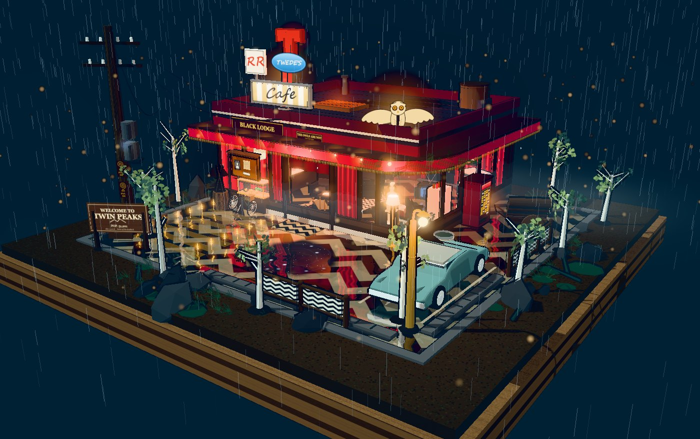

# Twin Peaks · Black Lodge 微缩场景

一个用 **three.js** 手写生成的三渲二（卡通渲染）微缩立体场景：华盛顿州雨夜松林里的街角「黑色旅舍」，
深红丝绒幕墙 + 弧形玻璃橱窗 + Twede's Cafe 立牌 + 黑白人字纹湿地面 + 会倒映星空的机油水洼。
可拖拽旋转、滚轮缩放，无任何 UI。



---

## 一、直接看效果

双击 `TwinPeaks-BlackLodge.html` 即可（**单文件、已内联全部依赖、无需联网、无需起服务器**）。
需要支持 WebGL2 的现代浏览器（Chrome / Edge / Firefox / Safari 16+）。

---

## 二、改代码

```bash
npm install        # 安装 three + esbuild
npm run build      # 打包 → TwinPeaks-BlackLodge.html
npm run watch      # 监听 src/，保存即自动重新打包（改的时候用这个）
```

打包产物有两个：
- `dist/app.js` —— 未内联的 bundle，方便调试
- `TwinPeaks-BlackLodge.html` —— 内联后的单文件成品，直接分发用

> 本地开发时也可以直接用 `index.html`（它引用 `dist/app.js`），配合任意静态服务器即可。

---

## 三、目录结构

```
src/
├─ main.js        入口：渲染器 / 相机 / 灯光 / 后处理 / 主循环 / 所有动效调度
├─ layout.js      全局尺寸常量（底座、建筑、门、水洼、电线杆、路灯的坐标）
├─ style.js       调色板、卡通材质 M()、描边、帷幕几何、通用几何体助手
├─ textures.js    全部 canvas 程序化贴图（人字纹地面、招牌、海报、猫头鹰剪影…）
├─ reflect.js     平面反射（镜像相机 + 渲染到 RT）
├─ base.js        底座、湿地面着色器、水洼着色器、12 棵树苗、森林地被、雾
├─ building.js    建筑外壳、玻璃着色器、幕布门、雨棚、屋顶、Twede's 招牌、猫头鹰
├─ interior.js    红房间室内全部陈设
├─ props.js       室外道具（贩卖机、自行车、手推车、轿车、电线杆、路牌…）
└─ fx.js          雨、电线、电弧、滴水、浮尘
```

---

## 四、想改哪里

| 想改的东西 | 去哪 |
|---|---|
| 相机初始角度 / 缩放范围 | `main.js` 里 `camera.position.set(...)`、`controls.target.set(...)`、`controls.min/maxDistance` |
| 整体亮度 / 色调 | `main.js` 的 `toneMappingExposure`、`hemi`、`moon`、`rim`、`fill` 四盏灯 |
| 辉光强度 | `main.js` 的 `new UnrealBloomPass(..., 0.42, 0.6, 0.86)` |
| 暗角 / 调色 | `main.js` 的 `gradePass`（`uVignette` 控制暗角） |
| 配色 | `style.js` 的 `PAL` 对象 |
| 建筑尺寸 / 位置 | `layout.js` 的 `L.bld`（改完 props 里的道具位置可能要跟着挪） |
| 招牌文字 | `textures.js` 的 `twedesOval()` / `rrPanel()` / `cafePanel()` |
| 室内陈设 | `interior.js`，每个道具是一个独立函数，坐标是绝对世界坐标 |
| 地面人字纹比例 | `textures.js` 的 `chevronTexture()` 末尾 `repeat: [1.9, 1.9]` |
| 地面湿度 / 反射强度 | `base.js` 里 `float wet = (0.40 + 0.18 * grainN) * uWet;` |
| 雨量 | `fx.js` 的 `COUNT` 和片元里的 `vA * 0.24` |
| 门开合节奏 | `main.js` 里 `doorTimer = 6.0` / `4.0 + Math.random() * 3.5` |
| 频闪频率 | `main.js` 里 `strobeNext = 4 + Math.random() * 7` |

---

## 五、几个关键实现（方便你继续改）

**三渲二**
`MeshToonMaterial` + 5 阶 `gradientMap`（`style.js` 的 `gradMap()`）。
描边是「反向壳」：`addOutline()` 给网格加一个 BackSide、沿法线按视距外扩的 ShaderMaterial 子网格，
在 `main.js` 的 `addSceneOutlines()` 里按包围球半径自动分级粗细。

**湿地面**
`reflect.js` 用镜像相机把场景渲到一张 768×768 的 RT，然后把 `uRefl` + `uTexMatrix` 注入到
`MeshToonMaterial` 的片元着色器里（`base.js` 的 `makeFloor()`），按菲涅尔混进反射，并叠加雨滴涟漪扰动。
注意：反射渲染时用 `exclude` 列表隐藏了底座 / 地面 / 水洼，**不要用全局裁剪平面**（three 的裁剪语义和直觉相反）。

**机油水洼**
`base.js` 的 `makePuddle()`：黑底 + UV 星场（星星锁在表面，远景才不会糊成一片）+ 采样同一张反射贴图 +
逆向收缩的同心波纹。

**丝绒帷幕**
`style.js` 的 `curtainGeometry()` 生成带褶皱的网格，并把「褶皱明暗」烘进顶点色；
`velvetMat()` 用 `onBeforeCompile` 注入一个正弦位移做无风轻摆。

**玻璃**
`building.js` 的 `makeGlassMaterial()`：菲涅尔 + 雨痕条纹 + 重影（双影）+ 水滴，全部在 shader 里程序化生成。

**性能**
场景约 1500 个网格。已做：小物件不投影、阴影图隔帧刷新、反射 RT 768、最远视距 42。
如果还想更快：把 `main.js` 里 `addSceneOutlines` 的阈值 `0.46` 调大（少画描边），
或把反射尺寸降到 512。

---

## 六、注意事项

- 招牌文字用的是系统手写体（Segoe Script / Brush Script MT）。换到 macOS 会自动落到
  `Lucida Handwriting`；如果两个都没有，会退回系统 cursive，字宽会变——`twedesOval()` 里已用
  `measureText` 做了自适应缩放，不会溢出椭圆。
- 所有贴图都是运行时 canvas 画的，没有图片资源，改文案直接改对应的 `fillText` 即可。
- 场景是「一体成型」的：改 `layout.js` 里的建筑尺寸后，室内家具（`interior.js` 用绝对坐标）
  和室外道具（`props.js`）可能需要跟着微调。

---

## 七、更新记录

**v1.0 初版** —— 完整场景：底座 / 湿地面反射 / 水洼 / 12 棵树苗 / 建筑外观 / 红房间室内 / 室外道具 / 雨夜动效。

**v1.1 招牌** —— 屋顶原「TWIN PEAKS」霓虹板替换为参考图的经典美式路边餐厅立牌：
红 T 字头 + 蓝色椭圆 `TWEDE'S` + 白底红字 `RR` + 黄白条纹 `Cafe`。
（`textures.js` 的 `twedesOval` / `rrPanel` / `cafePanel`）

**v1.2 清理穿模**
- 删除了伸出基座外的那条「实体走廊」（原 `interior.js` 的 `corridor()`），
  改为贴墙的 4 层嵌套暗色矩形 + 微光，做「帷幕深处」的假纵深，不再有外凸几何体；
  走廊灯也从墙外挪回室内。
- 12 棵树苗里有 2 棵落在建筑/雨棚投影范围内、从背幕穿出，
  现在生成时会检测占位并挪到建筑两侧空地（`base.js` 的 `relocate`）。
- 地被植物（蕨类、苔藓、石块、枯枝）原本只排除了「广场内」，
  没排除「建筑下方」，导致墙脚长草；已加 `inLodge()` 判断统一过滤。

> 想恢复成 10 棵树（两侧留空），把 `base.js` 里 `relocate` 的两行位置删掉即可。
