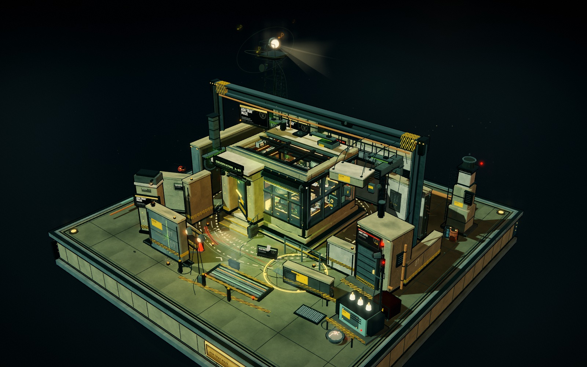
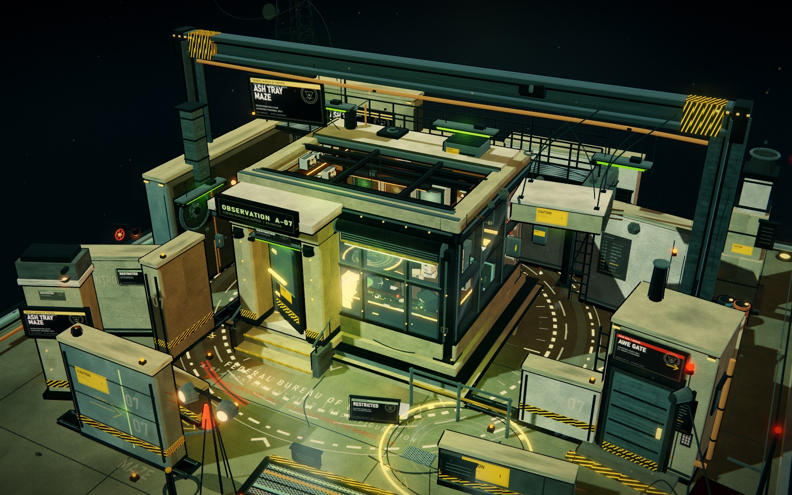
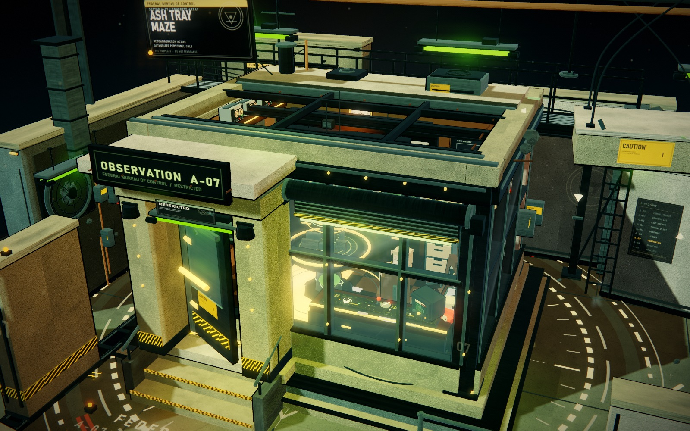
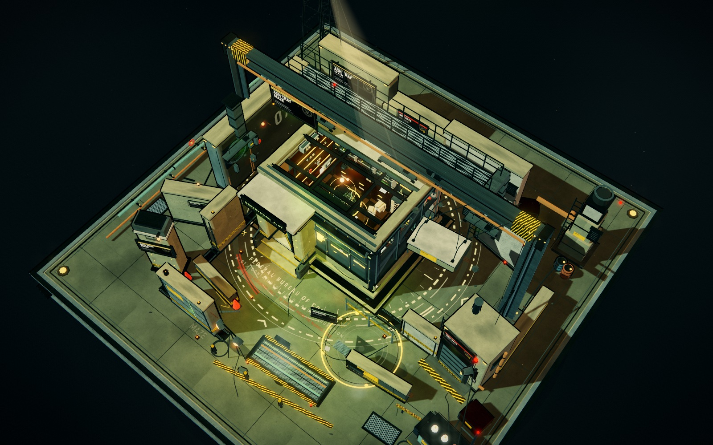

# ASHTRAY MAZE / A-07

> 联邦控制局异象微缩模型 · 粗野主义混凝土迷宫 · 交互式实时三维场景

这是一件完全由 Three.js 程序化生成的可交互微缩模型，没有使用 Blender，也没有加载任何外部模型、贴图或字体。它把《控制》里的“烟灰缸迷宫”重新想象成一件摆在黑色展台上的收藏级场景：一座完整的方形混凝土基座、中央厚玻璃观测控制室、可重组的混凝土墙体、头顶的钢梁与老式荧光灯、远处的探照灯塔，以及被暖色灯光照亮的密集内部。

## 观看

### 单文件版（推荐）

直接用浏览器打开：

`standalone/ashtray-maze.html`

这是自包含的单文件版本，Three.js、全部着色器、程序化纹理和 UI 样式都已内联。`file://` 离线打开即可运行，不需要服务器。

### 开发版

在本目录运行以下任一命令（无需安装依赖）：

    npm start
    # 或
    node tools/serve.mjs

然后打开 `http://127.0.0.1:5401/`。

> 正常浏览时页面不会发出网络请求。截图模式（`?capture=1`）只用于本项目自己的自动化捕获，不影响普通观看。

## 操作

场景内 **没有任何按钮、HUD、加载提示或说明文字**。所有操作都直接作用于模型：

- **拖拽**：环绕旋转
- **滚轮 / 双指捏合**：缩放
- **右键拖拽 / Shift + 拖拽**：平移
- **双击**：回到初始构图
- 停止操作约 17 秒后，镜头开始非常缓慢地自动环绕

## 场景内容

- 18.5 × 18.5 的完整方形粗野主义基座：分层的混凝土边缘、黄铜铭牌、铆钉、排水沟、轨道、磨损、油渍、烟灰缸与 FBC 徽记。
- 中央观测控制室：厚重的门廊、防爆玻璃、卷帘式防爆闸板、屋顶剖面、后墙 CRT 监视器组、左侧盘式磁带机墙、随身听与卡带、打孔机、控制台、沙盘与发光倒金字塔、档案箱、保险柜、样本柜、椅子、烟灰缸与内部暖光。
- 周围迷宫：可滑动的混凝土导墙、隐藏的 AWE 安检门、猫道、龙门钢梁、吊灯、探照灯、变压器、烟囱、管道、风机、检修沟、警告标志、地面禁闭区标记与黄黑警示带。
- 动态：墙体缓慢重组、荧光灯不规则闪烁、屏幕与沙盘呼吸、烟灰缸余烬、蒸汽、浮尘、空中纸片、漂浮音符与声音涟漪、探照灯扫动、信标灯闪烁。
- 视觉：三渲二 Toon 分阶、反向外壳黑色描边、自定义 Bloom / ACES / 色彩分级 / 暗角 / 颗粒 / 色差后处理，冷绿工业荧光与室内琥珀暖光的对比。

## 文件

    ashtray-maze/
    ├── index.html                 # 开发版入口（多文件）
    ├── package.json               # npm start / npm run build:standalone
    ├── standalone/
    │   └── ashtray-maze.html      # 自包含单文件版
    ├── src/
    │   ├── core.js                # 渲染器、灯光、相机控制、后处理
    │   ├── textures.js            # 程序化 Canvas 纹理与材质
    │   ├── base.js                # 方形基座与地面标记
    │   ├── maze.js                # 墙体、龙门架、探照灯、工业设备
    │   ├── interior.js            # 观测控制室与全部内部陈设
    │   ├── effects.js             # 蒸汽、浮尘、灯光、音符、后处理效果
    │   └── main.js                # 启动、截图模式
    ├── vendor/
    │   ├── three.min.js           # Three.js r152 UMD
    │   └── three.LICENSE
    ├── tools/
    │   ├── serve.mjs              # 本地静态服务器 + 截图接收
    │   └── build_standalone.py    # 单文件打包脚本
    └── gallery/                   # 最终展示图（JPEG）

## 技术说明

- 几何：全部由 Three.js 基础几何、放样、管道、自定义 BufferGeometry 和 Canvas 贴花构成。
- 材质：`MeshToonMaterial` + 5 段渐变贴图；通过 `onBeforeCompile` 注入边缘光；描边采用反向外壳着色器，保持近似恒定屏幕厚度。
- 光照：冷色主光、青绿色补光、暖色轮廓光、室内局部点光/聚光、外立面绿色荧光灯具、探照灯、红色信标。
- 后期：MSAA → Bloom → ACES tone mapping → gamma → 色彩分级 → 暗角 → 颗粒 → 色差。
- 性能参考：约 2,950 draw calls / 79k triangles（1600×1000，写入 GPU 截图）。像素比上限 1.5；建议开启浏览器硬件加速，使用独立显卡时最流畅。
- 无外部资产；正常浏览时无网络请求。
- 构建单文件版：`python tools/build_standalone.py`（需要 Python 3，无第三方依赖）。

## 展示图

| | |
| --- | --- |
|  |  |
|  |  |

更多图像见 [gallery/](gallery/) 和 [contact-sheet.jpg](gallery/contact-sheet.jpg)。

## 许可

Three.js 以 MIT 许可使用，见 `vendor/three.LICENSE`。其余场景代码、程序化纹理和图像由本项目生成。
