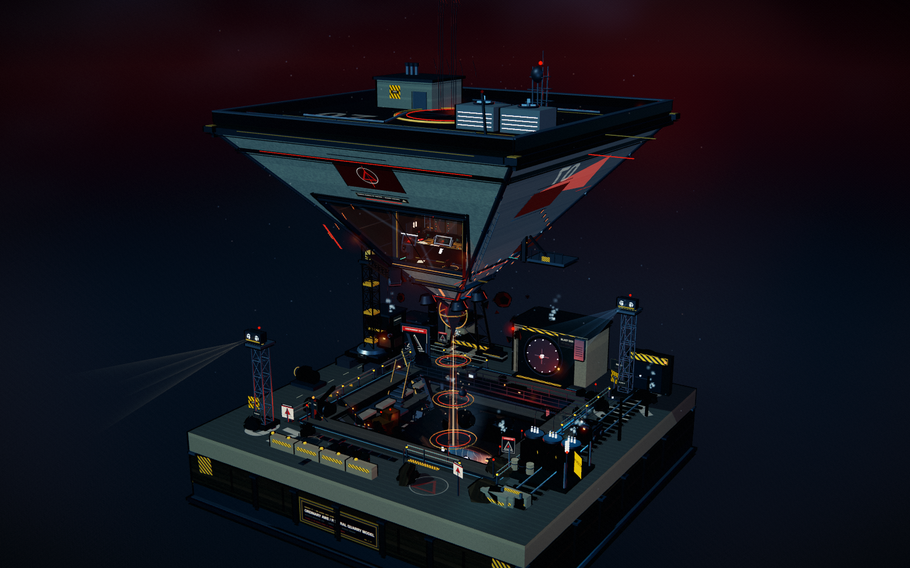
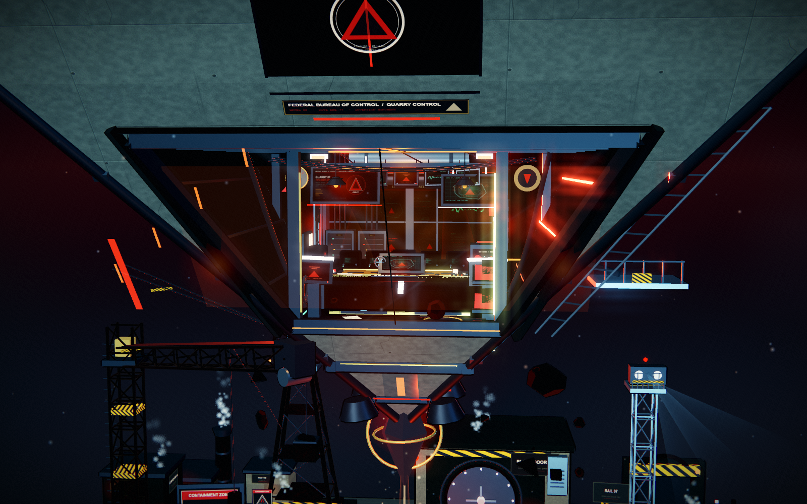
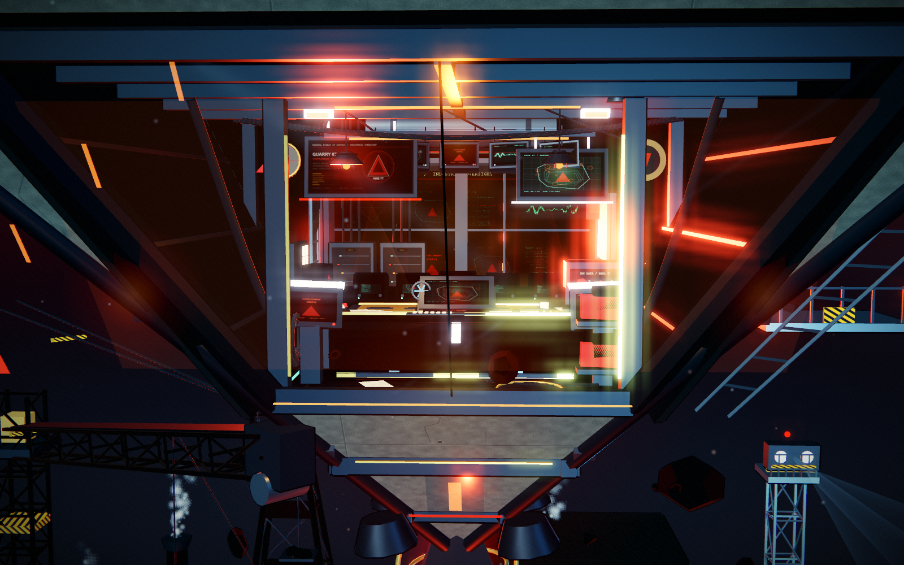
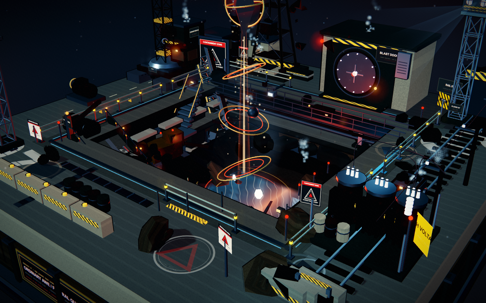
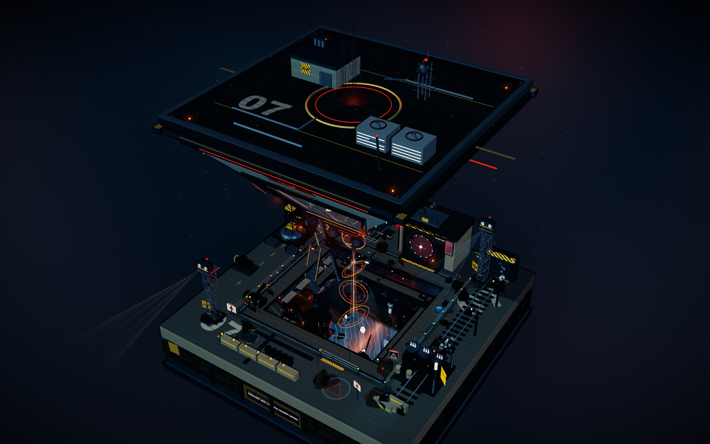
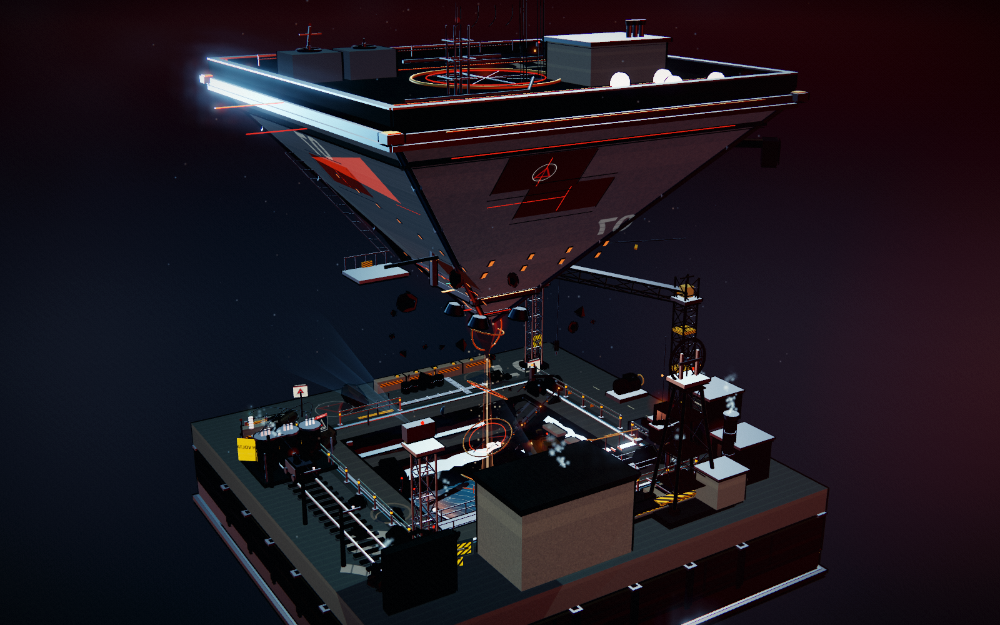
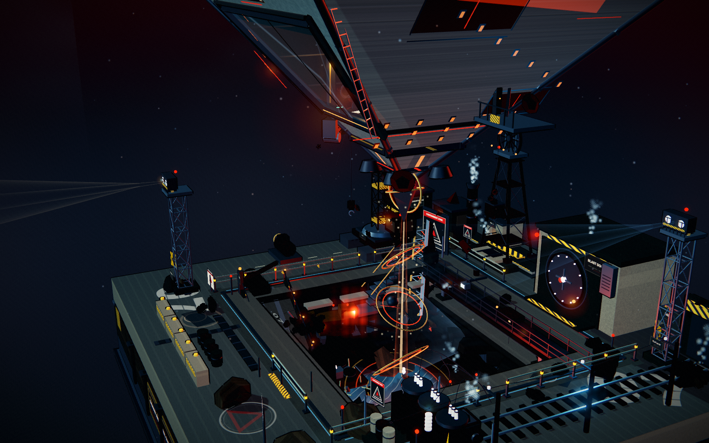

# FBC QUARRY 07 · 倒悬巨构采石场

> 一座悬浮在黑色采石场上的倒三角巨构。  
> 联邦控制局的混凝土纪念碑、失控的重力井，以及藏在倒三角内部的一间琥珀色控制室。  
> 全部由 Three.js、程序化 Canvas 纹理与 GLSL 实时生成；没有 Blender、没有 GLB/OBJ、没有外部图片或 HDR。



---

## 打开方式

**最直接：**

双击打开

`standalone/fbc-quarry-07.html`

这是将 Three.js、全部场景代码、Canvas 纹理与着色器内联后的单文件版本，不需要服务器或网络。建议使用开启硬件加速的最新版 Chrome / Edge。

**本地开发：**

```bash
cd fbc-quarry
npm start
# http://127.0.0.1:5392
```

重新打包单文件：

```bash
npm run bundle
```

页面没有任何按钮、控制条、文字说明层或 HUD。作品本身就是界面。

| 操作 | 效果 |
| --- | --- |
| 左键拖拽 / 单指拖拽 | 围绕模型旋转 |
| 滚轮 / 双指捏合 | 推近、拉远 |
| 右键拖拽 / Shift + 拖拽 | 平移观察中心 |
| 双击 | 回到全景视角 |
| 静置约 18 秒 | 缓慢自动环绕 |

---

## 场景

### 倒悬巨构
- 约 19 米宽、完全悬浮的倒置金字塔，顶部为整块黑色机械甲板与 07 标识、环形重力井、通风机组、通讯桅杆与红色航空灯。
- 清水混凝土与玄武岩面板、水平束带、红蓝识别灯、外挂检修梯与工具平台。
- 正面为整面梯形防爆玻璃，内部是可读的联邦局采石场控制中心。
- 外立面上反复出现 FBC 三角徽记、红黑警示条、编号 07、狭长的琥珀色窗缝和暗红色侵蚀光带。

### 控制中心
- 梯形断面的双层尺度指挥空间：悬挂 CRT 阵列、磁带机、服务器机柜、档案柜、打孔卡片机、厚重指挥台、地图桌、红色保密文件与导视地坪。
- 后墙为整面监控矩阵，显示采石场地形、异常读数、摄像机画面、机要代码与「AWE-77」收容状态。
- 红色应急灯箱、旋转警报灯、琥珀吊灯与冷暖屏幕光持续闪烁。
- 玻璃外框、内嵌钢梁、通风管、线缆、文件与细小按钮都保留实际厚度；镜头靠近时可以读到内容。




### 采石场底座
- 完整正方形重工业采石场基座：清水混凝土边缘、分层岩壁、铁锈雨水痕、收藏级铭牌与黄铜刻度。
- 三层下切台地、矿坑积水、碎石、排水沟、金属楼梯、矿车轨道、矿石溜槽、防爆门、变压器、管廊、龙门吊与探照灯。
- 倒三角的红色悬浮力场垂直贯穿坑底，在积水中形成反射与环状波纹。
- 低处的暖光、冷蓝积水、红色应急设施与暗色混凝土形成分层色彩。



### 其他角度





---

## 动效

- 反重力场中缓慢漂浮的尘埃与火星；数量更密、范围更广、大小不一的碎岩围绕倒三角底部缓慢公转。
- 倒三角本体极缓慢的上下浮动、微幅旋转错位，外挂金属板轻微漂移。
- 三座探照灯以不同周期缓慢扫射；两座塔楼灯组与倒三角底部灯带持续呼吸。
- 矿坑水面多频涟漪、控制室倒影和反射光斑；积水表面出现缓慢扩散的涟漪环。
- 管道、排水口与压力阀持续间断喷出蒸汽与白雾。
- 控制中心 CRT、监控墙、吊灯与应急灯闪烁；磁带盘旋转、桌面小风扇旋转、挂钟走针。
- 矿车沿右侧窄轨缓慢往返，龙门吊吊钩轻微摆动，挖掘机机械臂持续微小动作，皮带表面缓慢移动。
- 控制室悬挂屏幕与地图桌持续刷新；对低机位/高机位都保留可读内容。

---

## 技术说明

- Three.js r150，本地 vendored，无 CDN。
- 自研 5 阶 MeshToon 渐变、菲涅耳边缘、屏幕空间暗角/泛光/ACES/胶片颗粒、低强度后制。
- 所有混凝土、岩石、锈蚀金属、警示标牌、CRT 屏幕、机密文件、铭牌、玻璃反光与辉光贴图均由 Canvas 2D 在启动时程序化绘制。
- 轮廓线来自反向壳体描边 + 材质边缘墨化；没有使用后期 Find Edges。
- 渲染限制 DPR ≤ 1.4，静态阴影只刷新一次；场景约 7.9 万三角面，视角裁剪后约 2800–3000 draw calls。
- 没有角色；所有“人”的痕迹都是空椅子、文件、设备和一扇没有被完全关上的门。

---

## 文件结构

```
fbc-quarry/
├─ index.html                  开发入口
├─ package.json
├─ README.md
├─ src/
│  ├─ core.js                  渲染器、三渲二材质、灯光、相机、后期
│  ├─ textures.js              全部程序化 Canvas 纹理
│  ├─ base.js                  方形底座、采石场台地、岩壁、积水
│  ├─ pyramid.js               倒三角巨构、屋顶、控制室玻璃、悬浮力场
│  ├─ interior.js              控制中心与全部内部陈设
│  ├─ industry.js              吊机、轨道、传送带、变电所、探照灯
│  ├─ effects.js               浮尘、蒸汽、涟漪、氛围
│  └─ main.js                  启动与帧循环
├─ tools/
│  ├─ serve.mjs                本地静态服务器
│  └─ bundle.mjs               生成单文件
├─ standalone/
│  └─ fbc-quarry-07.html       可双击的离线版本
├─ shots/                      成品截图
└─ vendor/                     Three.js r150 + MIT 授权文件
```

---

## 说明

这是一件受 Remedy Entertainment 的《Control》世界观启发的非官方同人场景练习；相关名称、视觉符号与氛围仅作为致敬。Three.js 遵循 MIT 协议，许可证见 `vendor/three.LICENSE`。

*「The quarry looked back.」*
