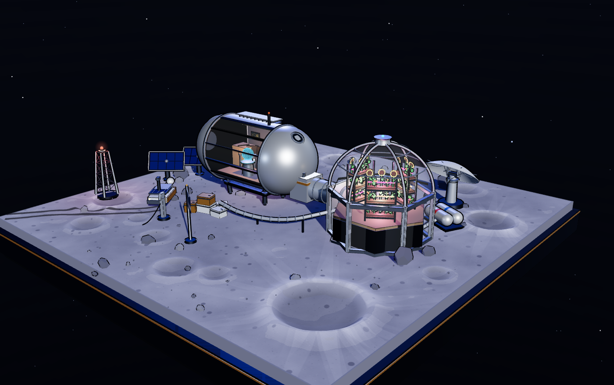

# 月球前哨站 · 微缩三维沙盘

一个用 Three.js 纯代码搭建的月球科考前哨站场景（无 Blender、无外部模型资源）。
所有几何体、贴图、材质都在运行时程序化生成，可自由拖拽 / 旋转 / 缩放观看，画面内无任何 UI 元素。



---

## 一、怎么打开

| 文件 | 用途 | 打开方式 |
|---|---|---|
| `index.html` | **CDN 版**，双击即开 | 需要联网（首次从 jsDelivr 拉 three.js，之后走浏览器缓存） |
| `index-offline.html` | **离线版**，依赖在 `lib/` | 必须起本地服务，见下方 |

离线版不能双击（ES Module 在 `file://` 下会被 CORS 拦住），用附带脚本：

```bash
# Windows
双击 serve.bat

# macOS / Linux
chmod +x serve.sh && ./serve.sh
```

脚本会起一个 `http://localhost:8080` 的静态服务并自动打开浏览器。

---

## 二、目录

```
lunar-outpost/
├─ index.html            CDN 版（单文件，约 84KB，全部逻辑都在这）
├─ index-offline.html    离线版（只有 importmap 指向不同，其余完全一致）
├─ lib/
│  ├─ three.module.js            three r169
│  ├─ OrbitControls.js           轨道控制
│  └─ BufferGeometryUtils.js     几何体合并（植物、岩石用）
├─ serve.bat / serve.sh  本地静态服务
├─ preview.png           当前画面截图
└─ README.md
```

> 改代码请只改 `index.html`，改完把 importmap 那 3 行换成 `./lib/...` 再存成 `index-offline.html`（或用脚本同步）。

---

## 三、性能现状（实测）

在 1200×760 视口、SwiftShader 软渲染下：

```
843 draw calls
154.8k triangles
```

URL 末尾加 `#fps` 会显示实时面板（默认不渲染任何 UI，加了 hash 才出现）：

```
index.html#fps
```

**结论：这是典型的 draw-call 瓶颈，不是面数瓶颈。** 15 万面任何独显都能吃下，但 800+ 次 draw call 在低端集显 / 移动端会掉帧。原因很明确——见下。

---

## 四、优化优先级（按收益从高到低）

### 1. 描边方案（最大头，约 400 次 draw call）

当前用的是「法线外扩壳」：每个需要描边的 mesh 都挂了一个 BackSide 子网格，几何体复用但**多一次 draw call**。

```js
// 第 3 章 · 描边工具
function hull(mesh, thick = 0.0016) { ... }   // 每个物体 +1 draw call
```

三条路线，按工作量排：

- **偷懒版**：把 `hull()` 改成空函数，只保留盒子的 `EdgesGeometry` 线稿（`edge()`）。立刻少 400 次 draw call，风格从「粗描边卡通」变成「细线稿」，其实更接近工业三视图。
- **折中版**：只给大体块（舱体、穹顶、天线、月球车）挂描边，小零件（螺钉、管线环、碎石）不挂。改法是在 `mesh()` 里根据尺寸判断，或手动把 `'hull'` 参数换成 `null`。
- **正解**：改成后处理描边——把 normal + depth 渲到一张 RT，全屏做 Sobel，一次 pass 搞定全部轮廓，还能做粗细随深度变化。代价是要引入 `EffectComposer`，`renderer.render` 换成 composer，约 100 行。

### 2. 像素比（高分辨率屏上的第一杀手）

```js
// 第 1 章
renderer.setPixelRatio(Math.min(window.devicePixelRatio, 2));
```

4K / Retina 上这是 4 倍像素量。改成 `1.5` 甚至 `1`，视觉损失很小、帧率翻倍。移动端建议：

```js
renderer.setPixelRatio(Math.min(window.devicePixelRatio, 1.5));
```

### 3. 阴影

```js
key.shadow.mapSize.set(2048, 2048);   // 第 1 章
renderer.shadowMap.type = THREE.PCFSoftShadowMap;
```

- 2048 → 1024：阴影 pass 的绘制量减半，月面这种低频地形基本看不出差别。
- `PCFSoftShadowMap` → `PCFShadowMap`：省掉一次 5×5 采样。
- 代码里有个 `shadowOn(obj)` 辅助函数（第 3 章）目前没用上——它的作用是给整棵子树批量开阴影。想彻底省，可以让 `castShadow` 只留给舱体、穹顶、天线这几个大件，小零件全关。

### 4. 地形细分

```js
const SEG = 190;   // 第 4 章，190×190 = 36k 顶点
```

120 就够（14.4k 顶点），陨石坑边缘会稍微软一点。降到 80 也还能看。

### 5. 点光源数量

场景里有 8 个 `PointLight`（舱内 3 + 穹顶 4 + 信标 1）。每个点光源都在逐像素计算，而且**默认不投影**，所以它们只是加色计算。中低端设备可以：

- 把舱内/穹顶的灯减到每个空间 1 个；
- 或全部改成 emissive 材质自发光（灯带、屏幕已经是 `MeshBasicMaterial` 了），靠 bloom 补光感。

### 6. 合批

植物和碎石已经用 `mergeGeometries` 合过了。还能合的是：舱体上的一堆小零件（散热片、加强筋、舷窗）、管线环、物资箱。按材质分组合并，能再砍 100+ draw call。代价是失去独立动画能力（这些本来就是静态的，没问题）。

### 7. 岩石 / 碎石实例化

第 15 章现在是把几十个岩石 merge 成 2 个 mesh。如果之后要加到几百个，换 `InstancedMesh` 更合适。

---

## 五、调参地图

### 构图 / 相机（第 1 章）

```js
camera.position.set(20.6, 12.6, 22.9);   // 机位：仰角约 24°，方位 45°
controls.target.set(1.0, 1.7, 0.15);     // 视线落点
camera.fov = 34;                          // 长焦感，变形小
controls.minDistance = 13;                // 最近能推到多近
controls.maxDistance = 85;
controls.maxPolarAngle = Math.PI * 0.495; // 卡住不让钻到地面以下
controls.autoRotateSpeed = 0.32;          // 空闲自转速度，0 = 关闭
```

底座整体前移了一点（`root.position.z = 1.0`），让站体在画面里居中。

### 灯光（第 1 章）

```js
key  = DirectionalLight(0xf6f9ff, 3.5)   // 主光，低角度太阳 → 长影
key.position.set(17.5, 10.5, 11.5)        // 压低 y 就能得到更长的影子
rim  = DirectionalLight(0x5478ff, 1.9)   // 背后冷蓝补光，勾边用
fill = DirectionalLight(0x9fb6d8, 0.45)  // 正面弱填充
hemi = HemisphereLight(0x8fa0c0, 0x05060a, 0.14)  // 环境，调低=更硬朗
renderer.toneMappingExposure = 0.96;      // 整体曝光
```

想要更「高级」的冷冽感：`hemi` 降到 0.08、`rim` 提到 2.4。
想要更「温暖」：`toneMappingExposure` 提到 1.1，舱内 `PointLight` 各加 3~4。

### 地形（第 4 章）

```js
const BASE = 22;          // 底座边长
const TERR_SIZE = 21.3;   // 月壤平面尺寸（比底座小 0.7，留出边框）
const CRATERS = [ {x, z, r, d}, ... ];   // 陨石坑：中心、半径、深度
function terrainH(x, z) { ... }          // 高度场：fbm 噪声 + 坑体剖面 + 边缘衰减
```

- 加坑：往 `CRATERS` 里 push 一条就行，`r` 半径 `d` 深度，坑会自带隆起的坑缘和外侧溅射纹。
- 站点周围会自动压平（`smoothstep(6.0, 9.5, dc)` 那段），改这两个数可以调整「平整区」范围。
- 月壤贴图在 `makeRegolithTexture()`：1024²，含月海暗斑 + 溅射纹 + 3 万颗碎石点。想省启动时间可以把 30000 降到 10000。

### 材质（第 2 章）

```js
M.hull      // 舱体银白金属
M.gold      // 金色隔热膜（月球车、物资箱、门框）
M.glass     // 高透玻璃：opacity 0.115 / envMapIntensity 1.25
M.panel     // 太阳能板深蓝
M.rock      // 月岩（flatShading 才有硬边）
```

玻璃想更「玻璃」：`opacity` 提到 0.18 并加 `transmission: 0.9`（`MeshPhysicalMaterial` 支持，但会多一次场景采样，低端机慎用）。
想更透（看清内部）：`opacity` 降到 0.06。

### 描边（第 3 章）

```js
function hull(mesh, thick = 0.0016)   // 0.0016 ≈ 2px 线宽，屏幕恒定
```

`thick` 是按「屏幕比例」算的（shader 里乘了 `-mv.z`），所以远近一样粗。想要更漫画可以给 0.003。

### 站点尺度

```js
station.scale.setScalar(1.2);   // 第 6 章前，整体放大 1.2 倍
station.position.y = TERR_LIFT; // 抬到月壤表面（否则会陷进去）
```

缩放锚点在站点原点（地面高度），所以放大不会离地。

### 动效

全部集中在 `updaters` 数组里，每个都是 `(dt, t) => {}`：

| 动效 | 位置 | 关键参数 |
|---|---|---|
| 天线旋转 | 第 10 章 | `yaw.rotation.y = t * 0.14` |
| 信标闪烁 | 第 11 章 | `(t * 0.85) % 1 < 0.42` 控制占空比 |
| 帆板追日 | 第 9 章 | `Math.sin(t * 0.28) * 0.055` |
| 气闸排气 | 第 7 章 | `puffTimer = 7.5` 秒一次，5 颗粒子 |
| 全息沙盘自转 | 第 6 章 | `moonBall.rotation.y = t * 0.55` |
| 屏幕闪烁 | 第 6 章 | `0.86 + 0.14 * Math.sin(t * 6 + i)` |
| 马克杯漂浮 | 第 6 章 | `Math.sin(t * 0.9) * 0.05` |

想暂停全部动画：把 `animate()` 里的 `for (...updaters...)` 注释掉即可。

---

## 六、代码结构（`index.html` 内 17 章）

| # | 章节 | 大约行号 |
|---|---|---|
| 0 | 基础工具（噪声、随机、缓动） | 30 |
| 1 | 渲染器 / 场景 / 相机 / 灯光 / 环境贴图 | 59 |
| 2 | 材质库 | 174 |
| 3 | 描边工具（`hull` / `edge`） | 223 |
| 4 | 月球地形（高度场、贴图、底座） | 279 |
| 5 | 场景容器与 `updaters` | 481 |
| 6 | 生活舱（含全部舱内细节） | 490 |
| 7 | 气闸 + 连接通道 + 排气粒子 | 983 |
| 8 | 生态穹顶（六边底座 + 玻璃罩 + 栽培架） | 1098 |
| 9 | 太阳能帆板阵列 | 1400 |
| 10 | 深空通信天线 | 1454 |
| 11 | 信标塔 | 1550 |
| 12 | 旗帜 | 1650 |
| 13 | 六轮月球车 + 充电桩 + 车辙 | 1715 |
| 14 | 物资箱 / 储罐 / 保温管线 | 1921 |
| 15 | 月岩与碎石 | 2053 |
| 16 | 星空 | 2106 |
| 17 | 全局动画循环（含 `#fps` 面板） | 2135 |

---

## 七、已知取舍

- **玻璃没有用 `transmission`**，走的是低透明度 + 环境反射。真透射要额外一次场景渲染，中低端机吃不消。想要物理正确可以自己换。
- **舱内照明不投影**，点光源会轻微「漏」到舱外地面。目前靠把 `distance` 收窄压住，没做阴影。
- **所有小零件都是独立 mesh**，为了代码可读性牺牲了合批。真要榨性能，第 6 章那些螺钉、把手、灯带都可以按材质合并。
- **贴图全是 Canvas 程序化生成**，首次加载约 100~200ms（主要花在 3 万颗碎石点和 1024² 噪声上）。可以预生成 PNG 换成静态贴图。
