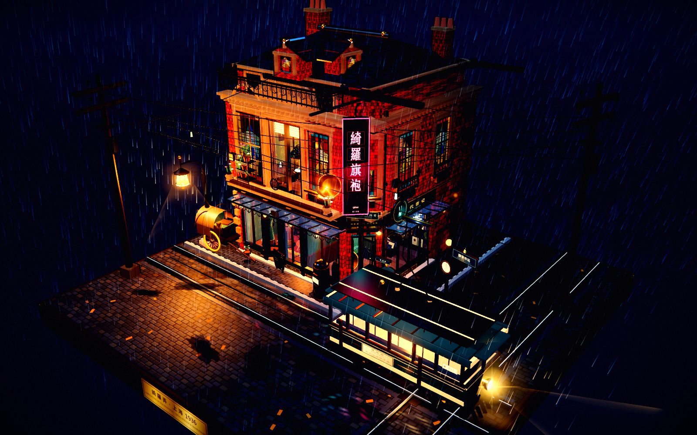
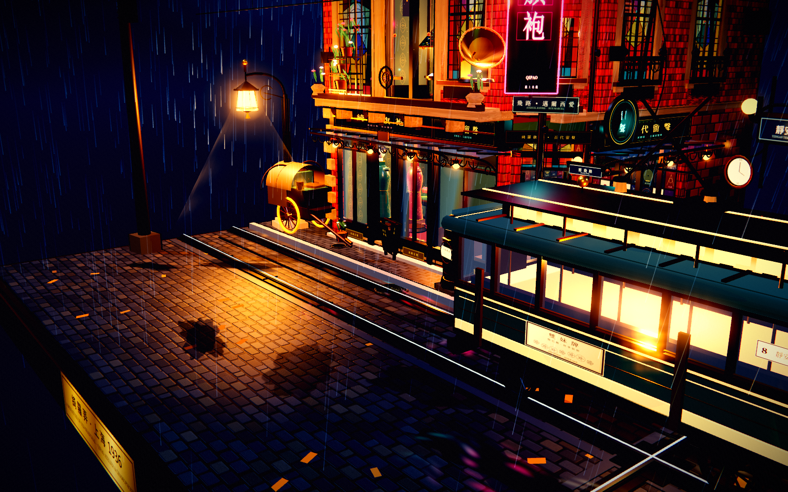
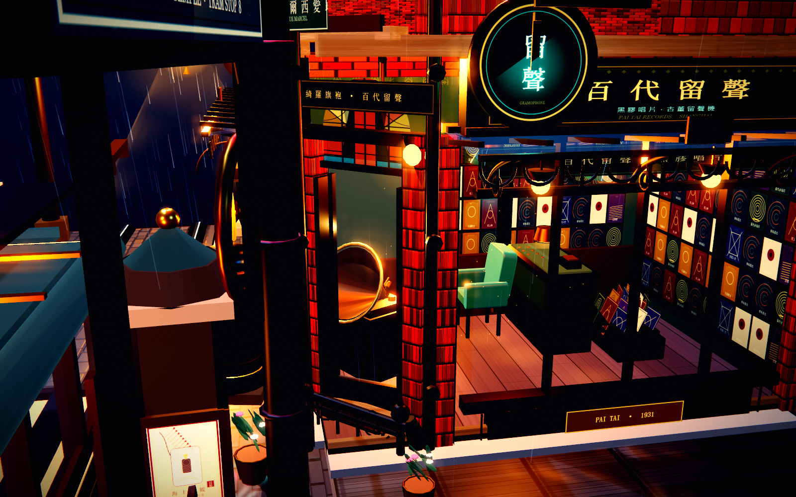
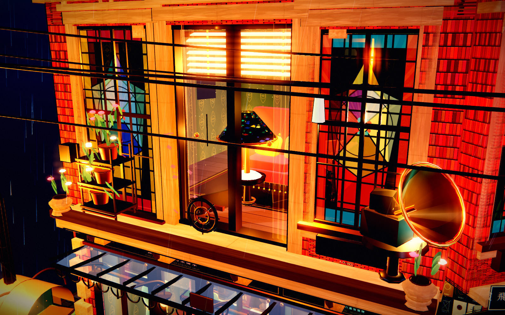
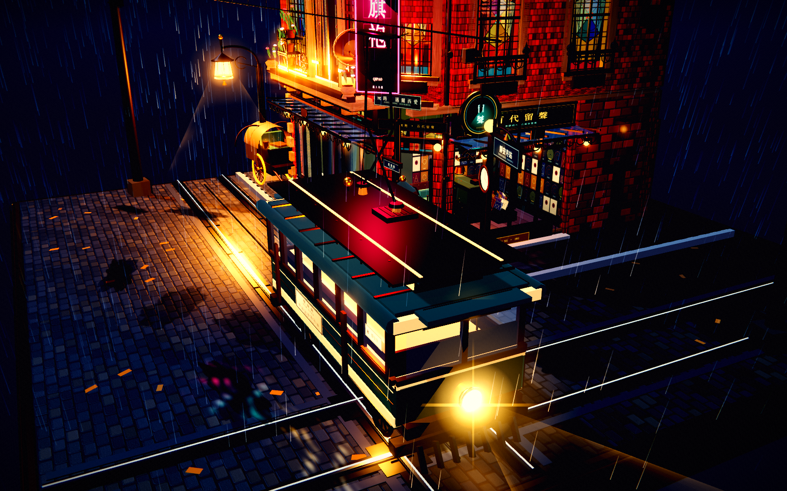
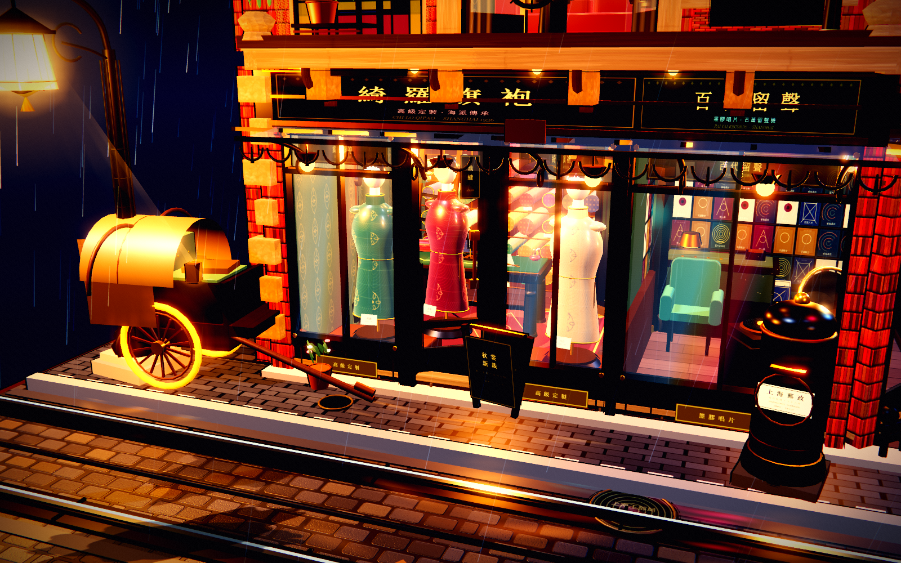
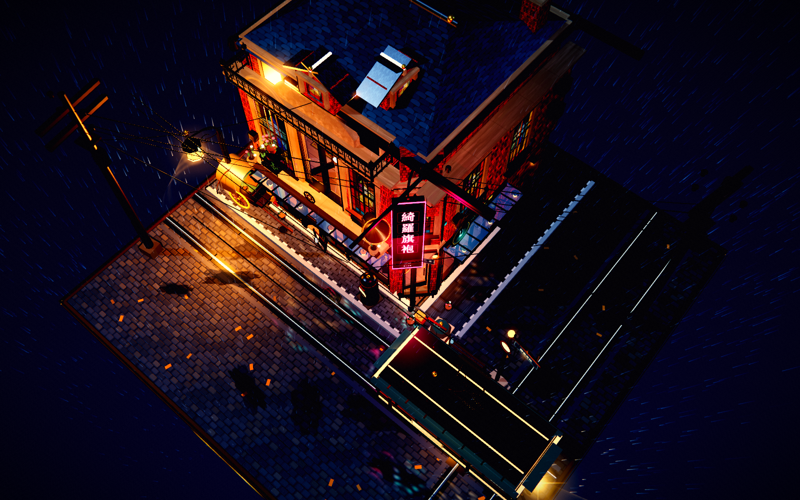

# 綺羅弄 · 旗袍與留聲
### 1936 上海街角 · 秋雨微縮景觀

> 轉角紅磚洋房裡，一樓是「綺羅旗袍」高級定製旗袍鋪與「百代留聲」黑膠唱片行，
> 二樓起居室的蒂芙尼燈映在彩色花玻璃上；門外是秋雨、電車、黃包車與流動的霓虹。
> 所有畫面均由 Three.js + Canvas 程序化生成，使用三渲二（toon）著色、描邊與自定義
> Bloom/ACES 後期，不含任何外部模型或貼圖，也沒有使用 Blender。

---

## 打開方式

**最簡單：離線單檔**

直接雙擊 \`standalone/qipao-diorama.html\`（約 0.87 MB，Three.js、全部程式碼與貼圖已內聯）。
不需要伺服器、不需要網路。建議使用開啟硬體加速的 Chrome / Edge。

**本地開發**

\`\`\`bash
cd qipao-diorama
node tools/serve.mjs
# http://127.0.0.1:5290
\`\`\`

場景沒有按鈕、面板或 HUD。它就是一件可以轉動、拉近觀看的微縮模型。

---

## 操作

| 操作 | 效果 |
| --- | --- |
| 拖曳 | 環繞旋轉 |
| 滾輪 / 雙指捏合 | 推拉縮放（10.5–38 視距） |
| 右鍵拖曳 / Shift + 拖曳 | 平移觀察中心 |
| 二十八秒無操作 | 開始緩慢自動環繞 |

支援觸控；窄屏會自動調整 FOV 與鏡距，保留完整景觀。

---

## 場景細節

### 轉角紅磚洋房
- 二層半石庫門式洋房：暗紅濕磚、青灰瓦頂、石庫門簷口、齒狀簷托、轉角隅石、
  老虎窗與煙囪。牆面使用程序化磚紋與 bump。
- 一樓為胡桃木框落地櫥窗；黑鐵雕花雨棚、黃銅燈具、扇形鐵藝簷口，雨珠沿棚緣下落。
- 二樓雕花陽台：鐵藝欄杆、石欄板、盆栽、鐵藝花架與陽台留聲機大喇叭。
- 彩色幾何花玻璃窗、蒂芙尼玻璃、雕花窗套與百葉窗；二樓室內透出鵝黃暖光。
- 轉角懸掛繁體 \`綺羅旗袍\` 直式霓虹招牌，燈管與描邊分層交替閃爍。

### 旗袍裁縫鋪
- 三尊穿戴刺繡絲綢旗袍的人台模型，立領、盤扣、鑲滾、裙衩與珠光緞面。
- 整面牆的彩色布匹卷、胡桃木裁床、黑金老式腳踏縫紉機、金剪刀、皮尺、針插與紙樣。
- 落地黃銅鏡、木地板、波斯地毯、暖光吊燈與陳列標籤。

### 留聲機唱片行
- 大面積胡桃木櫥窗與 L 形黑膠唱片牆；數十張 1930 年代風格的程序化唱片封套。
- 黃銅大喇叭留聲機、旋轉黑膠、老式收銀機、綠色天鵝絨扶手椅、唱片木箱。
- 轉角圓形「留聲」霓虹吊牌、青綠燈光與暖橙唱片行內景。

### 二樓起居室
- 酒紅絲絨流蘇沙發、老式撥盤電話、綠色玻璃閱讀燈、彩色蒂芙尼玻璃檯燈。
- 百葉窗、薄紗窗簾、波斯地毯、牆面 Art Deco 壁紙與黃銅相框。
- 陽台鐵藝花架、蘭花、留聲機大喇叭；白紗簾隨夜風微微拂動。

### 街道與廣場
- 完整正方形「彈格路」石鋪底座：程序化扇形小石塊、濕潤高光、積水與倒影。
- 有軌電車雙軌與十字軌道、嵌入式鋼軌、道岔區與排水溝。
- 墨綠色木製單節電車：亮著獨眼黃銅大燈、暖黃車廂、終點牌、車頂菱形受電弓。
- 英式弧形燈罩鑄鐵街燈、木電線杆、交錯架空線、火花與雨絲。
- 油布黃包車、黑色老式郵筒、月份牌石柱、電車站牌與候車長椅。
- 濕地反射流動的紅綠霓虹；水窪上有連綿漣漪。

### 動畫
- 細雨在路燈 / 車燈前變亮、連綿落下；地面水窪有雨滴漣漪。
- 直式霓虹燈管與黃銅邊框以不同節奏閃爍，紅綠光在積水中流動。
- 電車受電弓與架空線接觸處偶爾爆出藍白色電火花。
- 留聲機黑膠緩慢旋轉；二樓及陽台薄紗簾隨風飄動。
- 路燈光錐、雨霧、花瓣、暖光塵埃、車頭燈光束皆為實時動畫。

---

## 技術說明

- **渲染**：Three.js r150（MIT，授權檔在 \`vendor/three.LICENSE\`）。
- **三渲二**：自定義 5 段 toon ramp、fresnel 邊緣光、反向外殼描邊；
  共享材質的靜態幾何最後合批，兼顧分層質感與效能。
- **貼圖**：所有磚牆、石板、木紋、織錦、花玻璃、月份牌、報頭、招牌、
  唱片封套、霓虹字形、郵筒、車票、紙樣皆由 Canvas 2D 在啟動時繪製。
- **後期**：3× + 7× 雙層 Bloom、ACES 色調映射、色差、暗角、膠片顆粒，
  冷暗部 / 暖高光的分離調色。
- **程序化反射**：水窪上的霓虹倒影以動態 shader 生成流動色帶，
  與點光源、體積光錐、雨霧一起構成雨夜氣氛。
- **效能**：場景約 11.4 萬三角面；靜態合批把繪製呼叫從 ~2758 降至 ~850，
  測試環境（Chrome headless + SwiftShader，1600×1000）約 119 FPS。
- **無 UI**：沒有 HTML 按鈕、面板、文字浮層；所有招牌字樣都是場景中的實體。

---

## 目錄

\`\`\`
qipao-diorama/
├─ index.html                  開發入口（模組化 source）
├─ src/
│  ├─ core.js                  渲染器 / toon / 相機 / Bloom / 攝影預設
│  ├─ textures.js              全部 Canvas 程序化貼圖
│  ├─ ground.js                底座、彈格路、石階、軌道、水窪
│  ├─ building.js              紅磚洋房外觀、花玻璃、招牌、陽台、屋頂
│  ├─ interiors.js             旗袍鋪 / 唱片行 / 二樓起居室 / 道具
│  ├─ street.js                電車、黃包車、街燈、郵筒、月份牌柱、架空線
│  ├─ effects.js               雨、漣漪、霓虹閃爍、火花、倒影、窗簾風
│  ├─ optimize.js              靜態幾何按材質合批
│  └─ main.js                  啟動與主迴圈
├─ standalone/
│  └─ qipao-diorama.html       可離線雙擊的單檔版本（0.87 MB）
├─ tools/
│  ├─ serve.mjs                本地靜態伺服器
│  └─ bundle.mjs               重建單檔版本
├─ shots/                      效果截圖
└─ vendor/                     Three.js r150 + license
\`\`\`

重建單檔：

\`\`\`bash
node tools/bundle.mjs
\`\`\`

---

## 備註

- 本作品以「微縮電影布景 / 收藏級模型」為目標，非現實比例城市模擬。
- 場景中沒有活動人物；旗袍鋪中出現的是無臉人台模型。
- 所有畫面皆基於程式與 Canvas 繪製，專案內不包含任何 Blender 檔、OBJ/GLB、外部圖片或字型檔。
