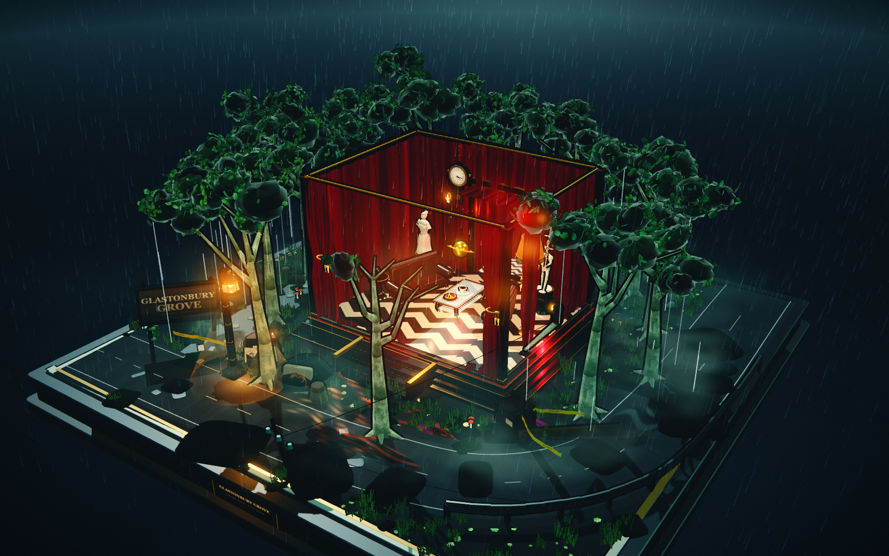
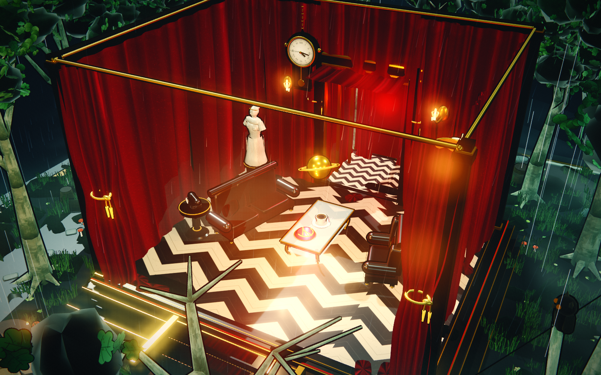
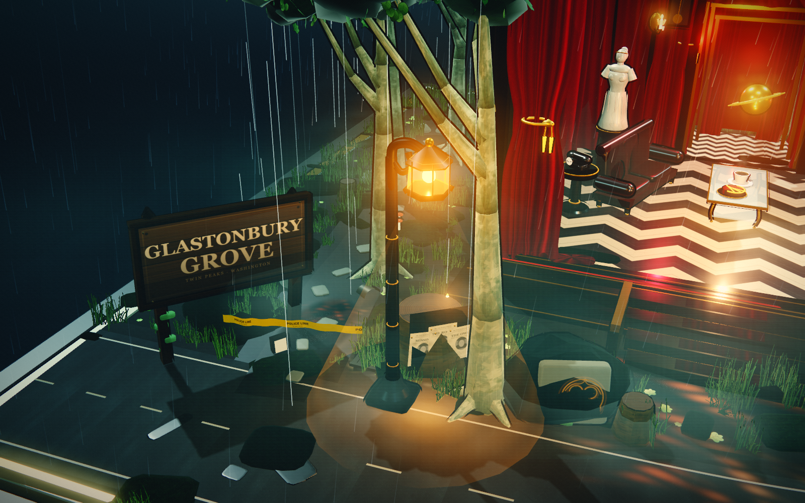
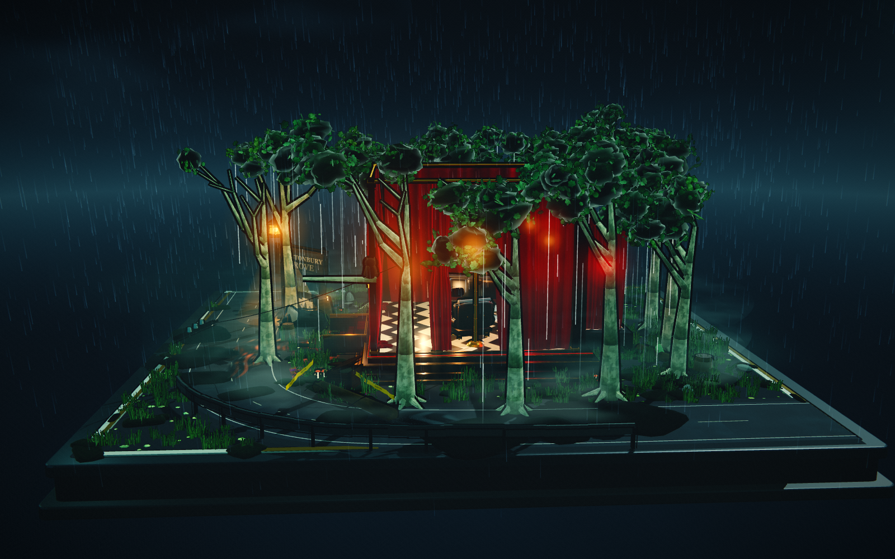
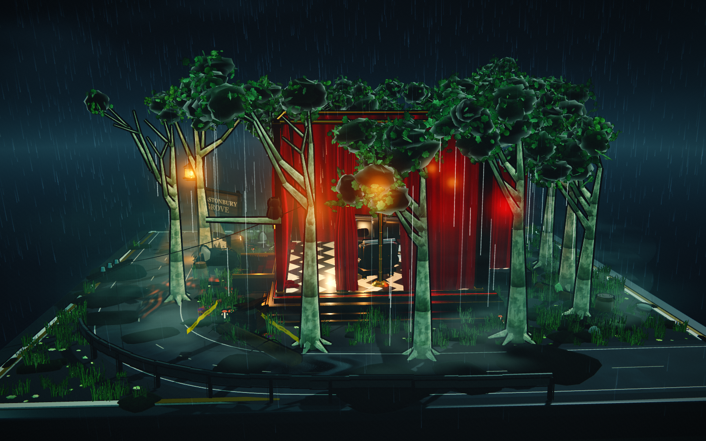
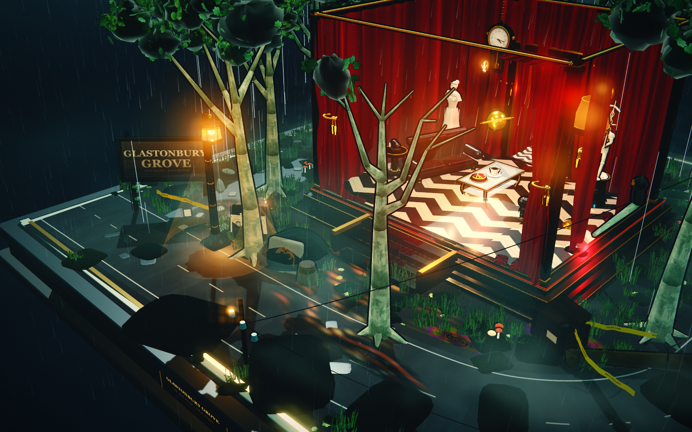
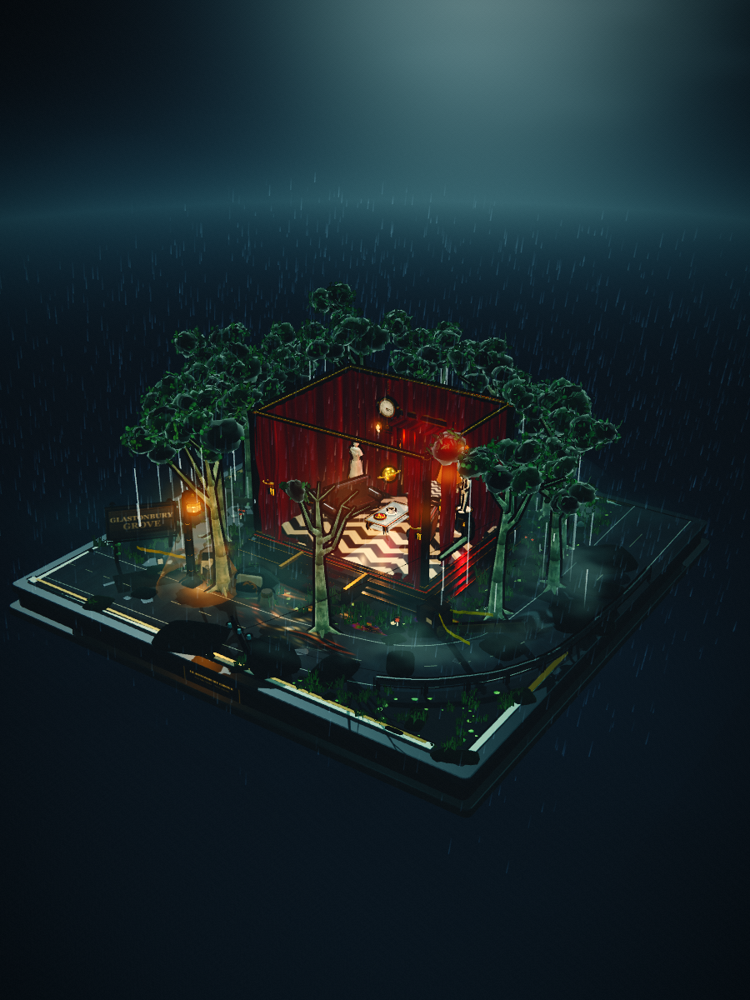

# Glastonbury Grove · The Red Room

一件完全程序化生成、可自由环绕观看的《双峰》雨夜微缩立体沙盘。没有 Blender、没有外部模型或图片；几何、材质、贴图、雨幕、雾、灯光与所有动效均由 Three.js 和 Canvas 2D 在浏览器中实时生成。



## 立即打开

双击 **standalone/twin-peaks-red-room.html**。这是单文件离线版，Three.js、源码与全部资源均已内联，断网可用。

可编辑源码入口为 `index.html`，各模块位于 `src/`，Three.js 位于 `vendor/`。

## 操作

- **左键拖拽 / 单指拖动**：自由环绕旋转微缩场景
- **滚轮 / 双指捏合**：推近、拉远
- **右键拖拽 / Shift + 拖拽**：平移观察目标（可选）
- **双击 / 按 R**：回到初始构图
- 画面内没有任何按钮、文字面板或 HUD；界面元素为零

建议使用 Chrome / Edge 桌面全屏观看；场景使用 WebGL 渲染并针对实时动画优化。

## 场景内容

- 完整的方形收藏级底座：深色木作台座、黄铜嵌线、红丝绒嵌条、湿石边缘、铭牌与木质/石质剖面
- 被半剖开的红房间：黑白人字纹（Chevron）地板、四面高耸深红天鹅绒帷幕、被拉开的厚重帷幕与金色束带
- 室内陈设：黑色皮革扶手椅与双人沙发、黑色大理石高脚圆几与复古转盘电话、玻璃茶几、黑咖啡、樱桃派、纯白大理石断臂维纳斯与执杖的墨丘利、金色土星摆件、古董挂钟、复古立式落地灯、通往下一层的帷幕长廊
- 外部 Glastonbury Grove：十二棵环形成圈的年轻悬铃木、破旧木质 “Glastonbury Grove” 路牌、荒野公路与拐角、反光公路边缘线、护栏、老式路灯、倾倒的木电线杆与下垂电线、Owl Cave 猫头鹰图腾岩石、黄色警用警戒线、复古木箱、树干年轮、排水沟、幽暗林间小径、失踪剪报木桩、蘑菇与蕨类
- 雨夜材质：湿沥青、泥泞小径、水洼、黑色机油水洼、树皮、天鹅绒、皮革、白色/黑色大理石的全部贴图均为运行时绘制

## 动效

- 持续冷雨、地面雨滴涟漪、树叶滴水
- 林间灰白薄雾与环形低雾缓慢流动
- 红房间落地灯轻微电流频闪、暖光呼吸
- 深红丝绒帷幕无风自动缓慢飘拂
- 黑咖啡液面轻微颤动与蒸汽
- 路灯与红房间的湿地反光、积水与路面上的绯红摇曳倒影
- 黑色机油水洼的逆向收缩波纹与虹彩薄膜
- 金色土星缓慢旋转漂浮；古钟秒针偶尔停滞又跳动
- 林间阴影中的猫头鹰眼睛偶尔一瞬微光

## 技术

- Three.js（本地 vendor，零网络请求）
- 自定义 cel-shading 材质、倒壳式屏幕空间描边、Toon 光栅阴影
- 自写 HDR bloom + ACES 色调映射 + 电影级调色/暗角/颗粒后处理
- 程序化 Canvas 2D 纹理：大理石、丝绒、树皮、人字纹地板、剪报、路牌、时钟、Owl Cave 符号等
- 全部几何按程序生成；无人物，无外部资产
- 模块源码：`src/core.js`、`textures.js`、`ground.js`、`forest.js`、`room.js`、`furniture.js`、`props.js`、`effects.js`、`main.js`

## 开发命令

```bash
npm start      # 本地预览 http://127.0.0.1:5292
npm run bundle # 重新生成 standalone/twin-peaks-red-room.html
```

## 更多画面

| | |
|---|---|
|  |  |
|  |  |
|  |  |

本作品为《双峰》主题的非商业同人场景创作；Twin Peaks 及相关设定的权利归其权利人所有。
