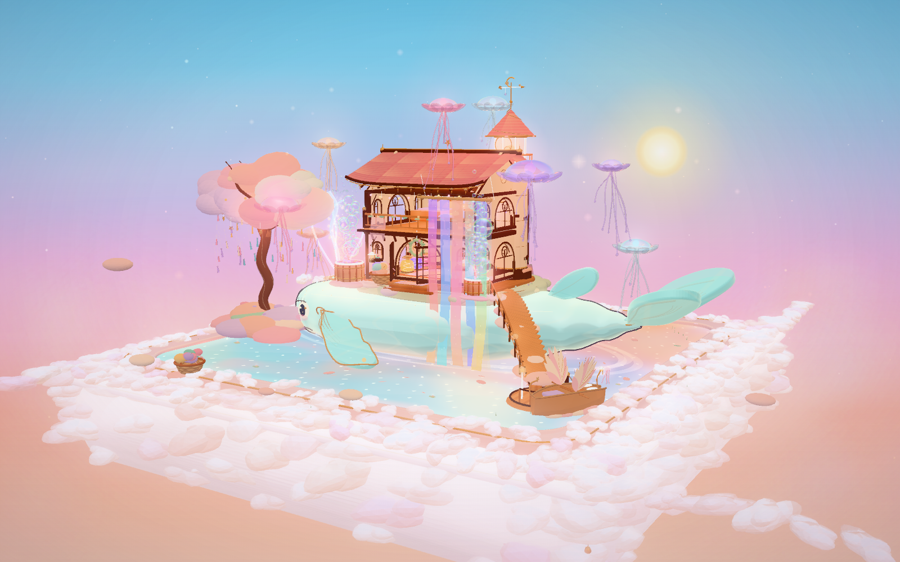
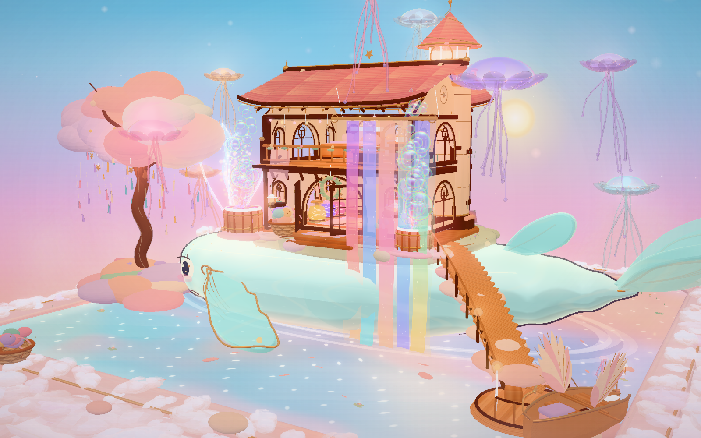
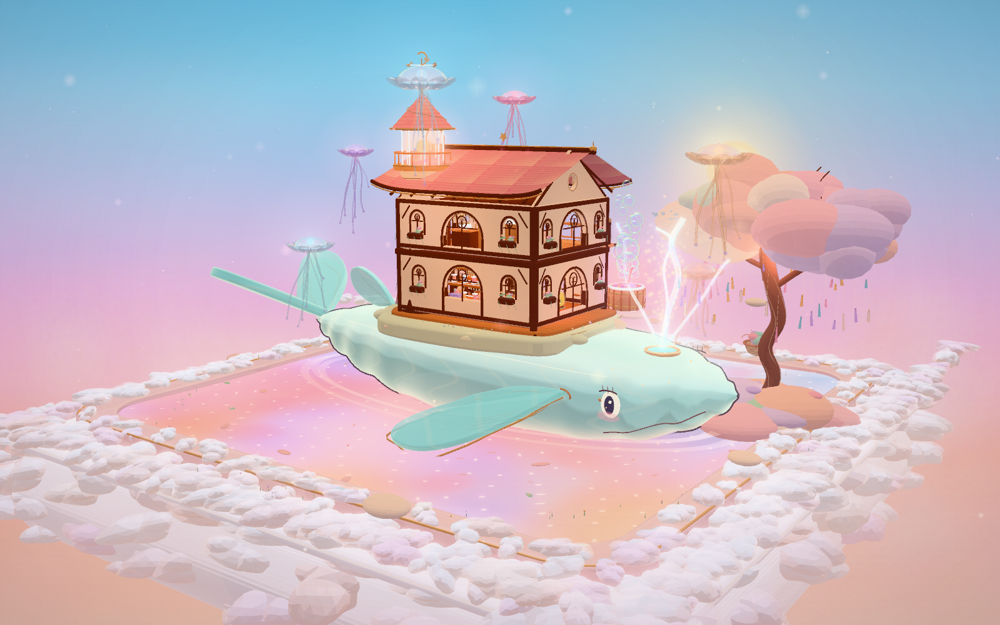

# 晚霞织梦染坊 · Sunset Dream Loom

一个完全由 **Three.js 程序化生成** 的微缩三维场景：粉霞云海上的飞空鲸鱼，托着一间可以自由旋转、缩放观赏的「晚霞织梦染坊 / 捕梦灯塔」。

没有使用 Blender，没有外部模型，也没有外部贴图或 CDN 资源。所有形体、材质、纹理、云层、水波与动画均由代码实时生成。

## 直接观赏

- **单文件版本（推荐）**：[dist/sunset-dream-loom.html](dist/sunset-dream-loom.html) / [dream-weaver-atelier.html](dist/dream-weaver-atelier.html)
  - 直接用现代浏览器打开即可，无网络依赖。
- 本地服务器：
  `bash
  node serve.mjs
  # 打开 http://127.0.0.1:4173/
  `
- 页面没有 HUD、按钮或文字提示，只有场景本身：
  - **拖拽**：旋转视角
  - **滚轮 / 双指捏合**：缩放
  - 视角被限制在天空半球内，避免转到基座下方。

## 场景里的东西

- 完整的正方形双层云海底座：下层是柔软、透光的棉花糖晚霞云；上层是抬升的幻彩天池，带金边与呼吸涟漪。
- 巨型半透明白玉飞空鲸：青玉色身体、暖粉腹部、金边胸鳍与 V 形尾鳍；鲸背承托整座染坊。
- 「晚霞织梦染坊」：四面通透的拱形花窗、敞开的木格门、暖光灯串、花箱、阳台、粉瓦屋顶。
- 捕梦灯塔：可发光的旋转梦境玻璃球、梦网装饰、弯月与星星铸成的风向标。
- 内部一览：粉色、紫色、金色染料的琉璃缸；自动织出星空的木织机；丝线架；黄铜蒸汽熨斗；云朵大床与羽毛抱枕；梦境玻璃球陈列柜；旋转八音盒；羽毛落地灯。
- 室外：从二层垂落云海的渐变晚霞丝绸瀑布、会呼吸的粉色空水母灯、七彩泡泡染缸、带着白色羽翼的小木船、许愿树与玻璃风铃、藤编云朵棉篮、鲸鱼喷出的星光水柱。
- 动画：染缸泡泡上升、织布机梭子穿梭、水母上下呼吸、丝绸随风摆动、云海翻涌、鲸鱼鳍与尾鳍轻轻摆动、瀑布与池水流动等。

## 技术细节

- 基于 **Three.js r186**。
- 三渲二风格：`MeshToonMaterial` + 自定义的 6 级柔和明暗渐变，以及柔和的倒模轮廓线。
- 自定义 GLSL 着色器：
  - 幻彩天池水波 / 日落反射
  - 晚霞丝绸的渐变、流动与微光
  - 白玉鲸的半透明边缘与极光纹理
  - 空水母的呼吸外壳
  - 彩虹肥皂泡的薄膜干涉
  - 云海棉花糖的柔软边缘与内部柔光
- Bloom、自定义天空画布、体积雾感云团与接触阴影共同完成画面。
- 所有贴图由 Canvas 2D 生成；天空、云朵、金边、模型与粒子均程序化。
- 无实时阴影贴图（用柔和接触阴影与自定义着色替代）；DPR 上限 1.5，兼顾观感与流畅度。
- `window.__dream` 保留了一个调试入口，方便后续二次开发；它不是 UI，不会显示在画面中。
- 已在 Chromium 中验证：控制台 0 错误，拖拽、滚轮缩放可用。

## 项目结构

`
dream-whale-atelier/
├─ index.html                 # 开发入口
├─ style.css                  # 只有画布、暗角和光标，没有界面元素
├─ app.js                     # esbuild 打包后的开发版
├─ src/
│  ├─ main.js                 # 场景装配、相机、灯光、后期
│  ├─ cloudbase.js            # 双层正方形云海 / 天池
│  ├─ whale.js                # 飞空鲸、鲸背岛屿、鳍尾、星光喷泉
│  ├─ atelier.js              # 染坊外壳、屋顶、灯塔、门窗、丝巾架
│  ├─ interior.js             # 两层室内陈设
│  ├─ silk.js                 # 丝绸瀑布与彩虹泡泡
│  ├─ jellyfish.js            # 空水母灯群
│  ├─ tree.js                 # 许愿树与玻璃风铃
│  ├─ boardwalk.js            # 鲸背木栈道、码头与羽翼小木船
│  ├─ vats.js                 # 云朵染缸、藤篮、木箱
│  ├─ flora.js                # 野花、草地、睡莲
│  ├─ sky.js                  # 画布天空、日照、环境贴图
│  ├─ materials.js / palette.js / lib.js / config.js
│  └─ ...
├─ dist/
│  ├─ sunset-dream-loom.html
│  └─ dream-weaver-atelier.html
├─ screenshots/
│  ├─ hero.png
│  ├─ closeup.png
│  └─ rear.png
├─ OPTIMIZATION.md            # 优化交接
├─ package.json
├─ build.mjs
├─ serve.mjs
├─ THIRD_PARTY_NOTICES.md
└─ .gitignore
`

## 安装与构建（二次开发）

> 源码包不包含 `node_modules`。若拿到的是 **Windows 离线包**，依赖已经包含在压缩包内，可以直接执行构建。
> 只需浏览场景时，不需要安装任何依赖，直接打开 `dist/dream-weaver-atelier.html` 或启动 `node serve.mjs` 即可。

首次构建前：

`bash
npm install
`

然后：

`bash
npm run serve          # 开发预览（默认端口 4173）
npm run build          # 构建 app.js
npm run build:single   # 构建 dist/ 单文件版本
`

或直接使用 `node build.mjs --single`。Node.js >= 18。

## 优化 / 二次开发

见 [OPTIMIZATION.md](OPTIMIZATION.md)，里面包含：

- 当前渲染结构、网格数量与已知 CPU draw-call 瓶颈
- `window.__dream` 调试句柄
- 静态合批、实例化、着色器、DPR / MSAA / Bloom 等优化建议
- 相机、光照、粒子数量等视觉效果入口

## 截图

## 第三方

Three.js 与 esbuild 的许可证说明见 [THIRD_PARTY_NOTICES.md](THIRD_PARTY_NOTICES.md)。

---

如果愿意，把它当作一个可以放在手心转动的小小乌托邦。
